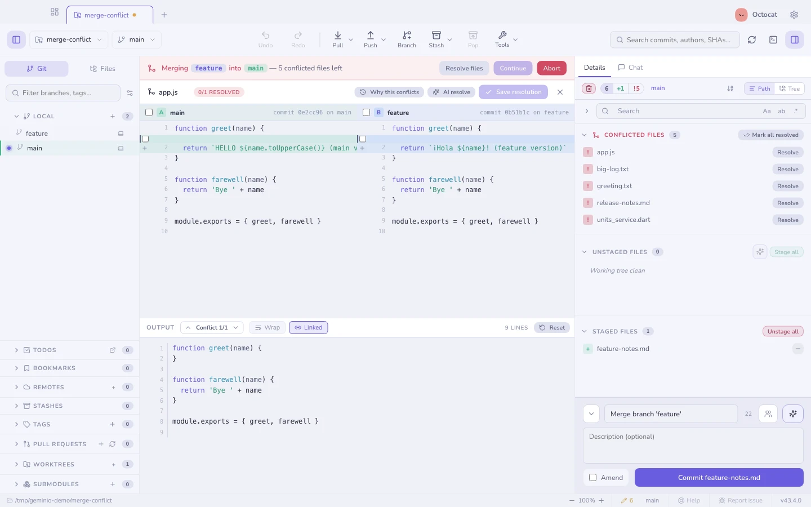

<div align="center">


# Geminio

**A desktop Git client for macOS, built with Electron, React and TypeScript.**

[Handbook](docs/help/getting-started.md) · [What Geminio changes](docs/geminio-changes.md) · [Development](CONTRIBUTING.md) · [Ideas & issues](https://github.com/kaschief/geminio-by-kash/issues) · [MIT license](LICENSE)


</div>

## About

Geminio is built and maintained by **Kaschief Johnson**. It started as a fork of
[Gitcito](https://github.com/MyAppDesk/gitcito) and has grown its own interface,
GitHub integration and workflow. Git runs only in Electron's main process; the
React renderer reaches it through one typed IPC channel that serialises calls
per repository. Tests run real Git against generated fixture repositories, and
every screenshot in the handbook is captured from the built app by Playwright.

## What Geminio adds

Everything Gitcito does, plus the changes below. Each line links to its
handbook page; [What Geminio changes](docs/geminio-changes.md) has the full
list, with what each change solves and its limits.

**Accounts**

- **Your GitHub account, no new sign-in.** Reuses a GitHub CLI login or Git's credential helper; a profile token still wins. [Connecting GitHub](docs/help/hosting.md#connecting-github)
- **Your photo on your commits.** The connected avatar appears in the title bar, Settings and on commits matching your account's emails. [Avatars](docs/help/avatars.md)
- **No vendor co-author.** Upstream's default `Co-authored-by: MyAppDesk` trailer and its setting are gone. [Committing](docs/help/committing.md)

**Tabs and workspace**

- **Nothing missed, nothing noisy.** The title-bar bell keeps only what you would act on — failures, commits from others, work done while you were away — with a dot for news, a red count and Dock badge for failures, and optional macOS notifications. [Notifications](docs/help/notifications.md)
- **Jump to any open repository.** ⌘J, a few letters, Enter — most recently used first, with each tab's status. [Going to a repository](docs/help/workspaces.md#going-to-a-repository)
- **Sort tabs by what needs you.** Conflicts, unpushed commits, changes, behind, name or recency — held, and re-applied without moving tabs mid-work. [Sorting tabs](docs/help/workspaces.md#sorting-tabs)
- **Unpushed counts on tabs.** A solid number for commits only this machine has, beside the changes dot. [Tab status dots](docs/help/themes.md#tab-status-dots)
- **Separate working views.** Each repository keeps its open commit or file, viewer mode, scroll, filters and unsaved edits across tab switches. [Workspaces](docs/help/workspaces.md#working-in-several-repositories)
- **A quieter title bar.** One dashboard icon for Mission Control, an optional accent outline on the active tab, and no button gap in fullscreen. [Mission control](docs/help/mission-control.md)
- **Missing folders, handled.** A moved repository shows Locate and Retry instead of startup errors. [Moved folders](docs/help/workspaces.md#moved-or-unavailable-folders)

**Graph**

- **Arrange it directly.** Right-click a header for columns; double-click a divider to fit them all; one layout for every repository. [Commit graph](docs/help/graph.md)
- **Unpushed commits stand out.** Dashed ring and dotted bar, with adjustable row accents and avatar ring. [Commit rows](docs/help/themes.md#commit-rows)
- **Dates and descriptions your way.** Relative, date & time or ISO, and an optional one-line description after each title. [Commit graph](docs/help/graph.md)
- **Straight to GitHub.** Commit hashes and branch menus link to their pages. [Commit details](docs/help/graph.md#commit-details)

**Changes and diffs**

- **Hunk and line actions everywhere.** Stage, discard, unstage, revert from a commit, apply from a stash — each undoable, with a three-way fallback. [Hunk and line actions](docs/help/staging.md#hunk-and-line-actions)
- **Inline diffs and moved code.** Small edits on one line with old words struck through, moved blocks tinted blue, whitespace ignored on request. [Diffs](docs/help/diffs.md#inline-layout)
- **Pull between files.** Pull past the end of a diff to open the next file. [Pull between files](docs/help/diffs.md#pull-between-files)
- **A steadier file viewer.** Header toggles that never jump, floating find, and path actions on right-click. [Diffs](docs/help/diffs.md)
- **File lists you can shape.** View as and Sort by on any right-click, path depth, and names that never truncate. [Staging](docs/help/staging.md#path-tree-and-order)
- **Filter by kind of change.** Click the modified, added or deleted count above any file list to show only those. [Commit details](docs/help/graph.md#commit-details)
- **Room for the message.** A resizable commit composer that remembers its height. [Committing](docs/help/committing.md)
- **Stashes that explain themselves.** An already-applied stash is offered for dropping; blocking files are named. [Stashes](docs/help/stashes.md#when-a-stash-will-not-apply)

**Recovery**

- **Undo what happened outside the app.** Commits, resets, merges and checkouts from a terminal or agent can be walked back, previewed first. [Recovery](docs/help/recovery.md#changes-made-outside-geminio)
- **One reset row.** "Reset *branch* to here" with Soft, Mixed or Hard, each saying what it keeps. [Reset](docs/help/merging.md#cherry-pick-revert-reset)

**Menus and feel**

- **State without tick marks.** A lit dot for the chosen option, a lit icon for what is on, and the current value on submenu rows.
- **Icons on every menu row,** one icon per meaning, and disabled rows that say why.
- **Mac-style capitalisation.** Title Case for controls and titles ("Copy File Path"), sentence case for descriptions and hints.
- **Menus close when you click away,** title bar included; unsaved repository editors keep Settings open. [Settings](docs/help/repo-settings.md)
- **Less noise.** Success toasts only for what you cannot see, slower tooltips on labelled controls, no scrollbars, and AI buttons only when AI is set up.
- **A smaller toolbar.** Compact selectors and one Pull/Fetch button that remembers its default. [Fetch and pull](docs/help/workspaces.md#fetch-and-pull)

**Settings and the app**

- **One searchable Settings window,** with the repository's settings as a section of it. [Finding a setting](docs/help/search.md#finding-a-setting)
- **Your app icon.** Twenty illustrated Dock icons to switch between, remembered after you quit. [App icon](docs/help/themes.md#app-icon)
- **No stacked Keychain prompts** from background polling, and no Safe Storage prompt when there is nothing to unlock.
- **Upstream announced, never installed.** The updater shows Gitcito releases but opens their notes instead of overwriting this build.

| | |
|---|---|
|  |  |
| **Resolving a merge conflict** | **Staging a single line** |

## Working with Git

| Area | What is available |
|---|---|
| [History](docs/help/graph.md) | Commit graph, branch and author filters, blame, file history and commit notes |
| [Changes](docs/help/staging.md) | Stage whole files, hunks or individual lines; unified and split diffs |
| [Branches](docs/help/branching.md) | Branch management, merge, rebase, stacked branches and remote operations |
| [Conflicts](docs/help/conflicts.md) | Three-pane conflict resolution and external merge-tool support |
| [Recovery](docs/help/recovery.md) | Reflog, undo and redo (including commits and resets made outside the app) and working-tree snapshots |
| [GitHub](docs/help/hosting.md) | Pull requests, reviews, issues, CI information, and links from any commit hash or branch to its page |
| [Repositories](docs/help/repositories.md) | Tabs, groups, workspaces, repository search and favorites |
| [Tools](docs/help/editor.md) | Open in an editor, integrated terminal, code search and file previews |
| [AI](docs/help/ai.md) | Optional commit assistance, explanations and repository chat using configured providers |
| [Repository rules](docs/help/repo-config.md) | `.geminio.json` for shared rules, protected branches, commit scopes and checks |

The [handbook](docs/help/getting-started.md) covers the wider toolset and its
limits. The maintained documentation language is English; inherited translations
remain available and use English fallbacks for new UI text.

## Run locally

Development currently focuses on **macOS**. The project also retains Windows
and Linux packaging configuration; those builds are not validated as part of
the current macOS workflow.

```sh
npm install
npm run dev
```

The dev app runs from this checkout with its own settings, separate from an
installed copy. If Electron reports a missing installation, run
`node node_modules/electron/install.js`, then try again.

To build and install the app on an Apple Silicon Mac:

```sh
npm run install:mac
```

It builds an unsigned arm64 bundle, replaces `/Applications/Geminio.app`
(keeping a custom app icon), and leaves one registered copy. `npm run dist:mac`
builds the full installer instead; signing and notarisation depend on your
build credentials. Geminio publishes no release builds yet, and upstream
Gitcito builds do not contain Geminio's changes.

## Command line

In the command palette (`⌘K`), choose **Install 'geminio' command in PATH**.

```sh
geminio .
geminio ~/kash-code/my-project
geminio blame src/app.ts -l 40
geminio doctor
```

See the [CLI guide](docs/help/cli.md) for commands and Git editor integration.

## Settings, data and compatibility

Settings and repository metadata are stored locally. Secrets use Electron's
OS-backed encryption with keychain consent. GitHub authentication can reuse the
GitHub CLI or Git's credential helper; Geminio does not need its own hosted
account service. Network-backed features contact the relevant Git host, avatar,
update or optional AI service. [Security and secrets](docs/help/security.md)

The rename preserves earlier saved data. Existing `.gitcito.json` repository
rules and encrypted `.gitcito` bundles remain readable. Some internal storage
keys and Git refs retain their old names for compatibility.

## Development and documentation

Work in the existing checkout. Keep changes focused and verify them with:

```sh
npm run typecheck
npm run lint:i18n
npm run lint:docs
npm test
npm run build
```

Tests use real Git fixture repositories. UI screenshots come from the running
app, with scenarios declared in `examples/screenshots/shots.config.mjs`.

- [CONTRIBUTING.md](CONTRIBUTING.md) — setup, gotchas, taking upstream changes,
  the handbook and the website.
- [CLAUDE.md](CLAUDE.md) — the working agreement for people and agents:
  architecture, the UI house style, and the checklist every change passes.
- [What Geminio changes](docs/geminio-changes.md) — the running list; every
  user-facing change adds or updates an entry.
- [ROADMAP.md](ROADMAP.md) — what might come next, and what is deliberately out.

## Origins and license

Geminio originated from **[Gitcito by MyAppDesk](https://github.com/MyAppDesk/gitcito)**.
That project provided the foundation; Geminio's direction, customization and
ongoing development are maintained by Kash.

The project remains **MIT licensed**. Original copyright and license notices
are preserved in [LICENSE](LICENSE), alongside the dependencies' notices.
Upstream releases may be announced, but are never automatically installed over
Geminio. Upstream changes are reviewed and integrated into this project; the
fork's own changes are listed in [What Geminio changes](docs/geminio-changes.md).
