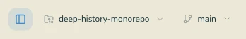

<div align="center">


# Geminio

**Kash's Git client. Built around a personal workflow.**

A desktop home for repositories, branches, changes and GitHub—shaped by daily use on macOS.

[Handbook](docs/help/getting-started.md) · [Development](CONTRIBUTING.md) · [Ideas & issues](https://github.com/kaschief/geminio-by-kash/issues) · [MIT license](LICENSE)


</div>

## The Geminio approach

Geminio is developed and maintained by **Kash (Kaschief Johnson)**. It began
with Gitcito and has grown into a personal Git client with its own interface,
account integration and workflow decisions.

The focus is a workspace that remembers how you like to work: compact controls,
consistent layouts across repositories, direct access to GitHub, and fewer
competing places to configure the app.

- **Your GitHub account.** Reuse an existing GitHub CLI login or configure a
  token in Settings → Integrations. Your connected photo appears in the title
  bar, Settings and matching commit authors. [Connecting GitHub](docs/help/hosting.md#connecting-github)
- **One Settings window.** Appearance, accounts and application preferences
  share a window with a Repository section for the current repository's rules,
  signing, info and other options. [Settings](docs/help/repo-settings.md)
- **One arrangement across repositories.** Graph column order, widths and
  visibility—and sidebar section order, visibility and expansion—carry across
  repositories. Branch pins remain specific to their repository. [Layouts](docs/help/workspaces.md)
- **A graph you can arrange directly.** Right-click any column header to choose
  visible columns; drag to rearrange or resize them, and double-click a divider
  to fit the loaded history. [Commit graph](docs/help/graph.md)
- **Separate working views.** Each repository keeps its open commit/file, viewer mode,
  scroll position and unsaved file edits when switching tabs. [Workspaces](docs/help/workspaces.md#working-in-several-repositories)
- **Pull between files.** An adjustable elastic pull at the end or beginning of a diff
  previews the adjacent file, then switches when you release past the threshold.
  [Reading changes](docs/help/diffs.md#pull-between-files)
- **Your app icon.** Choose a Dock icon style and color in Appearance settings.
  [App icons](docs/help/themes.md#app-icon)
- **Room for the message.** Drag the divider above the commit composer to give
  the description more space. The height is remembered. [Committing](docs/help/committing.md)
- **A quieter title bar.** A compact monochrome mark, workspace management in Settings,
  and no window-button gap in macOS fullscreen. Missing saved folders have a reconnect view. [Tabs](docs/help/workspaces.md)
- **A smaller toolbar.** Compact repository and branch selectors, plus one
  Pull/Fetch button whose dropdown chooses the default operation. [Navigation](docs/help/repo-menu.md)
- **Predictable menus.** Click outside a menu to close it. Repository editors
  with unsaved changes stay open when you click the Settings backdrop.



## Working with Git

| Area | What is available |
|---|---|
| [History](docs/help/graph.md) | Commit graph, branch and author filters, blame, file history and commit notes |
| [Changes](docs/help/staging.md) | Stage whole files, hunks or individual lines; unified and split diffs |
| [Branches](docs/help/branching.md) | Branch management, merge, rebase, stacked branches and remote operations |
| [Conflicts](docs/help/conflicts.md) | Three-pane conflict resolution and external merge-tool support |
| [Recovery](docs/help/recovery.md) | Reflog, undo and redo (including commits and resets made outside the app) and working-tree snapshots |
| [GitHub](docs/help/hosting.md) | Pull requests, reviews, issues, CI information, and links from any commit hash or branch to its page |
| [Repositories](docs/help/repositories.md) | Tabs, groups, workspaces, repository search and favorites |
| [Tools](docs/help/editor.md) | Open in an editor, integrated terminal, code search and file previews |
| [AI](docs/help/ai.md) | Optional commit assistance, explanations and repository chat using configured providers |
| [Repository rules](docs/help/repo-config.md) | `.geminio.json` for shared rules, protected branches, commit scopes and checks |

The [handbook](docs/help/getting-started.md) covers the wider toolset and its
limits. The maintained documentation language is English; inherited translations
remain available and use English fallbacks for new UI text.

## Run locally

Development currently focuses on **macOS**. The project also retains Windows
and Linux packaging configuration; those builds are not validated as part of
the current macOS workflow.

```sh
npm install
npm run dev
```

The demo runs from this checkout. If Electron reports a missing installation,
run `node node_modules/electron/install.js`, then try again.

To build the app and a macOS installer:

```sh
npm run build
npm run dist:mac
```

Signing and notarization depend on your build credentials. For a local unsigned
Apple Silicon app bundle:

```sh
CSC_IDENTITY_AUTO_DISCOVERY=false npx electron-builder --mac dir --arm64 --publish never -c.mac.identity=null
```

The bundle is written to `dist/mac-arm64/Geminio.app`. Use
[Geminio's repository](https://github.com/kaschief/geminio-by-kash) for this
project; upstream Gitcito builds do not contain Geminio's changes.

## Command line

In the command palette (`⌘K`), choose **Install 'geminio' command in PATH**.

```sh
geminio .
geminio ~/Code/my-project
geminio blame src/app.ts -l 40
geminio doctor
```

See the [CLI guide](docs/help/cli.md) for commands and Git editor integration.

## Settings, data and compatibility

Settings and repository metadata are stored locally. Secrets use Electron's
OS-backed encryption with keychain consent. GitHub authentication can reuse the
GitHub CLI or Git's credential helper; Geminio does not need its own hosted
account service. Network-backed features contact the relevant Git host, avatar,
update or optional AI service. [Security and secrets](docs/help/security.md)

The rename preserves earlier saved data. Existing `.gitcito.json` repository
rules and encrypted `.gitcito` bundles remain readable. Some internal storage
keys and Git refs retain their old names for compatibility.

## Development and documentation

Work in the existing checkout. Keep changes focused and verify them with:

```sh
npm run typecheck
npm run lint:i18n
npm run lint:docs
npm test
npm run build
```

Tests use real Git fixture repositories. UI screenshots come from the running
app, with scenarios declared in `examples/screenshots/shots.config.mjs`.
See [CONTRIBUTING.md](CONTRIBUTING.md) for the workflow and
[HANDOFF.md](HANDOFF.md) for current project context.

## Origins and license

Geminio originated from **[Gitcito by MyAppDesk](https://github.com/MyAppDesk/gitcito)**.
That project provided the foundation; Geminio's direction, customization and
ongoing development are maintained by Kash.

The project remains **MIT licensed**. Original copyright and license notices
are preserved in [LICENSE](LICENSE), alongside the dependencies' notices.
Upstream releases may be announced, but are never automatically installed over
Geminio. Upstream changes are reviewed and integrated into this project.
