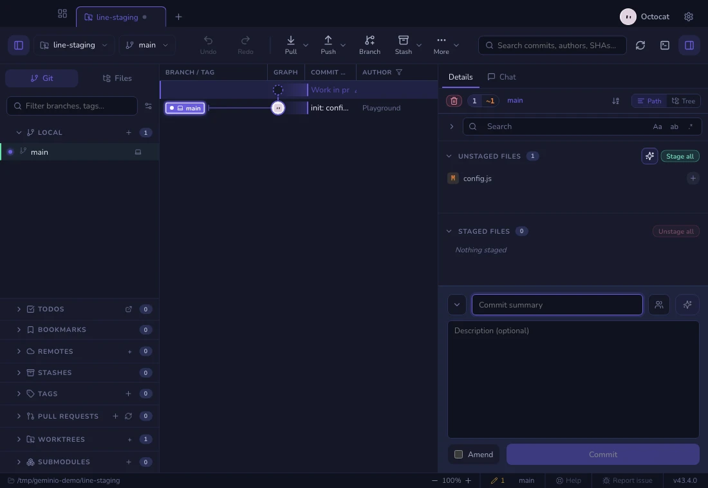
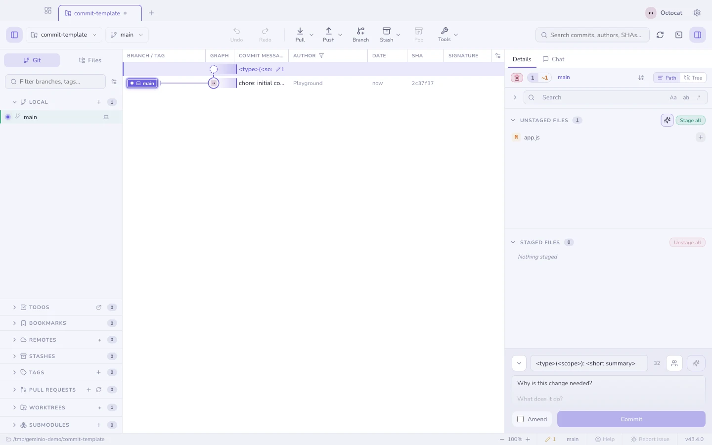

# Committing

Drag the divider above the commit message up or down to resize the whole
message section. The description fills the available room, and Geminio
remembers the height while keeping space for the file lists.

## Message styles

Pick one in Settings; the composer adapts to it.

| Style | Looks like |
|---|---|
| **Conventional** | `feat(api)!: add rate limiting` — with a type dropdown |
| **Gitmoji** | `✨ add rate limiting` — with an emoji picker |
| **Ticket** | `ABC-123: add rate limiting` — seeded from the branch name |
| **Plain** · **Auto** | Whatever you type; Auto lets the AI decide the shape |
| **Caveman** · **Haiku** | Exactly what they sound like |

## Things the composer does for you

- <kbd>↑</kbd> <kbd>↓</kbd> recalls your **recent messages**.
- A **co-author picker** adds `Co-authored-by:` trailers from the repository's
  own contributors.
- `commit.template` / `.gitmessage` **prefills** the message, comment lines
  stripped.
- During a merge, cherry-pick or revert, the message is **pre-filled** the way
  git would.
- Drafts **persist** per repository, so switching tabs never loses a message.

## The linter

A live, non-blocking check: subject length (with a character counter), a
trailing period, the mood of the first word, over-wide body lines. Hints, never
a gate — it will not stop you committing.

Each hint names the one thing to change, judged by **the repository's own
habits**, read from its recent commits. Where most subjects start with a
Conventional type, a subject without one is asked for a type, never for a
capital; where the text after the type is lower case, `feat: Add …` is pointed
at, because commitlint's `subject-case` would reject it (an acronym too:
`feat: add API docs` passes, `feat: API docs` does not). A profile set to
Conventional Commits counts even before the history shows it.

A word is judged only once it is finished — after the space that follows it.
Typing `t` on the way to `test:` is not a mistake, and nothing appears until
the first word is done.

When a commit hook rejects the message, the error names the rule that failed
— "the hook wants the text after the type in lower case", "use one of: feat,
fix, docs" — instead of a general "rejected". A rule Geminio does not know
keeps commitlint's own words.

*Limits:* the style is inferred, not read from your commitlint config, so a
repository with very little history gets the general hints. A trailing period
is flagged as you type it, even mid-number.

## Amend

Amend rewrites the last commit with whatever is staged. Geminio shows you the
existing message first so you are editing, not retyping.

**Amend commit…** on a graph row does the same thing for HEAD: it loads the
full message, switches the composer into amend mode, and focuses it. A HEAD
that was already pushed can still be amended, but Geminio warns that updating
the remote will take a force push.

**Undo puts the message back.** Undoing a commit — the toolbar's Undo, or
<kbd>⌘Z</kbd> — returns its message and description to the composer along with
its staged changes, so one more fix can go in before committing again. Redo
takes the message back out. An undo never overwrites a message you have typed:
it only fills an empty composer, or one still holding the message a previous
undo put there. Undo several commits in a row and the composer shows the last
one undone, while their changes gather in Staged.

**Details follows the commit.** Commit while Details shows your working
changes and it moves to the new commit instead of closing. A file you had open
closes, so what you see is the result: the commit highlighted in the graph, its
message, and every file that went into it. (A commit made *outside* Geminio
while you read a file works the other way — the file stays and follows into the
commit; see [When the file changes under you](diffs.md#when-the-file-changes-under-you).) Undo while it shows
that commit and it moves to the working changes the undo left behind; after an
amend, to the rewritten commit. It never sits on "Commit not found".

**Undo commit…** is the sibling for an unpushed HEAD: mixed reset to the
parent, working-tree changes kept, message restored to the composer. The
initial commit has a dedicated path that leaves an unborn branch instead of
destroying the files.

**See also:** [Staging](staging.md) · [Absorb](absorb.md) · [Changelog generator](changelog.md)
