# Diffs & previews

## Reading a diff

In the file viewer the toggles sit in its header, as a row of icons next to
**File view · Diff view · Blame · History**. Hover one for its name. In
comparison dialogs, which have no header of their own, they float over the
top of the diff with their labels. A toggle that does not apply to the current
view stays in place but greyed out, so the row never shifts under the pointer.

The first group picks the **layout** — one of three:

| Layout | What it shows | Use it when |
|---|---|---|
| **Unified** (default) | Old lines above new ones, in one column | Reading a change top to bottom |
| **Split** | Old on the left, new on the right | Comparing two versions of a block side by side |
| **Inline** | A small edit as a single line: removed words struck through in red, added words lit in green, a `~` in the margin | Reviewing many one-word fixes — renames, constants, typos — without reading every line twice |

The second group holds the toggles, which apply to any layout:

| Toggle | What it does |
|---|---|
| **Ignore whitespace** | Hides reindentation so the real change surfaces |
| **Word-level** | Highlights just the changed tokens inside an edited line — red on the old, green on the new |
| **Moved code** (on by default) | Tints blocks that were only moved, not changed, in blue |
| **Wrap** | Folds long lines inside their row (or column, in split view) instead of scrolling the diff sideways |
| **Linked** (split, wrap off) | Scrolls both halves together, vertically and sideways — off, each column scrolls on its own |
| **Find** / <kbd>⌘F</kbd> | Find inside the diff, with next/previous stepping; <kbd>Esc</kbd> closes it |

Wrap is off by default, so one line stays on one row. In split view that keeps
the two sides comparable row for row, with each half carrying its own sideways
scrollbar. Turn
it on when you would rather read a long line than chase it — the cost is that a
line folding over three rows on one side no longer sits opposite its
counterpart. Every toggle remembers its state across files and sessions.

With wrap off the two halves scroll **linked** by default — vertically, which
keeps the rows facing each other, and sideways, so column 90 on the left sits
above column 90 on the right. Unlink them when the sides have drifted apart —
an indented block against an unindented one, a rename that shifted every line —
or when you want to compare two distant regions of the same file, and park each
half where its own content is.

### Diff zoom

The last group, **− 100% +**, zooms the diff on its own. Shrink it to fit more
of a change on screen — code, line numbers, `@@` bars and the **Revert hunk** /
**Stage hunk** buttons all scale together, as if you had zoomed the app, while
the rest of the window stays the size it was. <kbd>⌘</kbd> + scroll (or a
trackpad pinch) over the diff does the same; click the percentage to go back
to 100%.

The level runs from 50% to 200%, is shared by every diff in the app and is
remembered across sessions. It sits on top of the app zoom in the status bar
and the code font size in Settings, rather than replacing them: those still
size everything else. *Limits:* the find bar and the toggles themselves keep
their size, so they stay easy to hit at 50%.

### Inline layout

Inline merges a removed line and the added line that replaced it only when
the result is easier to read than the two lines were. A pair stays as an
ordinary − line over a + line when:

- more than about half of its characters changed — the strike-throughs
  would swamp what is left;
- the change is whitespace only, which has nothing visible to strike through;
- the removed and added lines do not pair one to one (three lines replaced by
  five): which old line became which new one would be a guess;
- either line is part of a moved block, or the file's secret values are masked.

So an inline diff is usually a mix: one-line edits merged, rewrites left as
they were. Selecting an inline line for a [line action](staging.md#hunk-and-line-actions)
selects both its old and its new half, so **Stage lines**, **Discard lines**
and the rest act on the whole edit the line shows. Copying text from an inline
line copies the new text only — the struck-through words cannot be selected.
Find matches the old words too, since they are on screen.

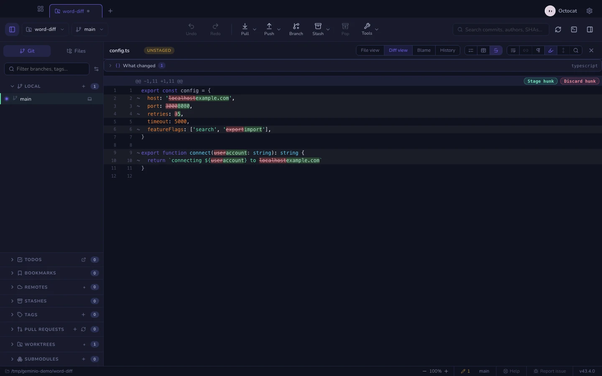

### Moved code

A block that was cut from one place and pasted in another shows up in a diff
as a deletion and an unrelated-looking addition. **Moved code** recognises
the pair, after git's own `--color-moved`: a run of deleted lines that
reappears, line for line, as a run of added lines elsewhere in the same file's
diff. Both ends get a blue tint, and the margin shows an arrow pointing at the
other end — hover it for the line number. Neighbouring moved blocks alternate
between two shades of blue so you can tell where one ends.

Lines are compared without their leading and trailing whitespace, so a block
moved into a deeper indent still counts. Limits: like git, a block needs at
least 20 letters and digits to count, so a shuffled `}` or `return` is not
flagged; it only looks within one file, so code moved to another file is a
deletion here and an addition there; and a block that was moved *and* edited
is not marked — only the unchanged lines around the edit are, if there are
enough of them. Re-indenting lines in place is not a move.

### Ignoring whitespace

**Ignore whitespace** re-reads the diff with `git diff -w`, so a reformat or a
change of indentation drops out and the lines whose content changed remain.
Hunk and line actions keep working while it is on: the patch they apply
matches the file's whitespace loosely, so they change exactly what the
visible diff shows, and the whitespace-only changes hidden from view stay
where they are — still unstaged, still in the working copy. To stage or
discard the whitespace changes too, turn the toggle off first. The toggle is
remembered across files and sessions, like the others.

In Geminio light mode, unselected header controls use a softer grey; the
selected mode and enabled toggles retain their purple highlight.

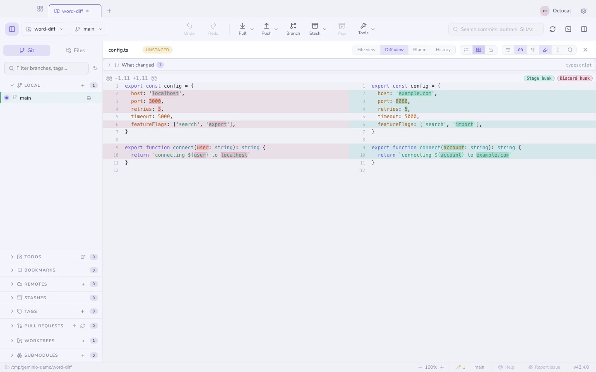

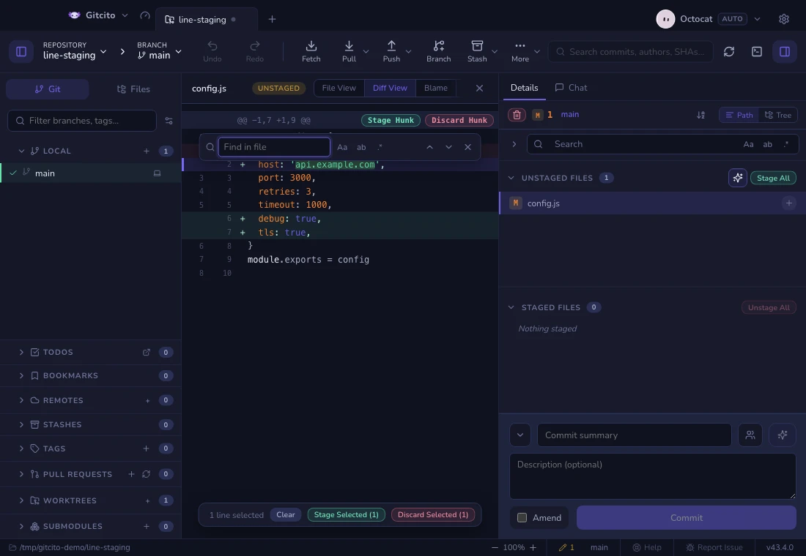

The header controls scroll horizontally when the pane is narrow. Find and
selected-line actions float within the viewer without moving the code.

## When the file changes under you

A working-tree file stays open while something else works on it — a terminal,
an editor, or an agent you asked to commit. The viewer keeps up instead of
going stale, so the chip in its header — Unstaged, Staged, or a commit — always
says where the file is now:

| What happens outside Geminio | What the open file does |
|------------------------------|-------------------------|
| The file is staged | Switches to the **Staged** diff |
| The file is unstaged | Switches back to the **Unstaged** diff |
| Part of the file is staged | Stays on the side you chose; both are real |
| The file is committed | Follows it into the new commit, so the diff stays on screen — and Details, if it was showing your working changes, moves to that commit too |
| The change is discarded or stashed | Closes, as there is nothing left to show |
| The commit you are reading is undone | Goes back to the **Staged** or **Unstaged** diff, wherever the change landed |
| …and its changes thrown away (`reset --hard`) | Closes — the change exists nowhere now, and the commit underneath is a different one |
| That commit was `HEAD` and is amended or reworded | Moves on to the rewritten commit |

This is for changes you did not make here. Committing from Geminio's own
composer is different on purpose: the file closes and Details shows the new
commit with all its files, because when you commit, the result is what you
want to see.

If you had closed Details yourself, it stays closed. With no file open,
committing the last change still closes Details: an empty working tree has
nothing to show.

A commit that leaves history some other way — rebased away further back, say —
keeps its view: its content still exists, and guessing where it went would be
the surprise.

*Limits:* while you are editing the file in place, the viewer holds still, so
an unsaved draft is never thrown away. It also only follows into the commit
that `HEAD` now points at. If several commits land at once and the file is not
in the newest one, the view closes.

## Pull between files

When reading a commit, stash, or staged/unstaged file list, scroll to the bottom
of the current diff, pause, then pull a little further. The view stretches to
show the next filename and a circular progress indicator. Keep pulling until
the ring fills and **Release to open** appears, then stop scrolling. A brief
release animation marks the switch before the next file slides into place. A shorter pull springs back. At the top, the same
gesture opens the previous file at its bottom.

The pause separates your deliberate pull from trackpad momentum. One gesture
moves one file, following the visible list's sort order and filters. It stops
at the first and last file and keeps staged and unstaged files separate.
It works in unified and split diffs, and in read-only File view. Horizontal
scrolling, zooming, and editing a file do not switch files. Press **Esc** to
cancel a pull. Scrolling inside the newly opened file works immediately.

In **Settings → Files & diffs**, turn **Pull between files** on or off and
choose **Fast**, **Quick**, **Balanced**, or **Deliberate** under **Pull feel**. Balanced
is the default. Fast is a little lighter and quicker than Quick. Quick needs a shorter pull and switches faster; Deliberate
keeps the longer stretch and slower transition. These settings apply across
all repositories.

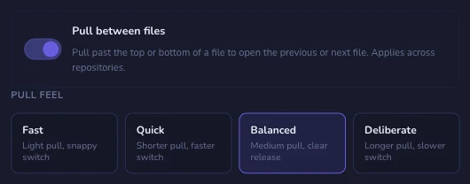

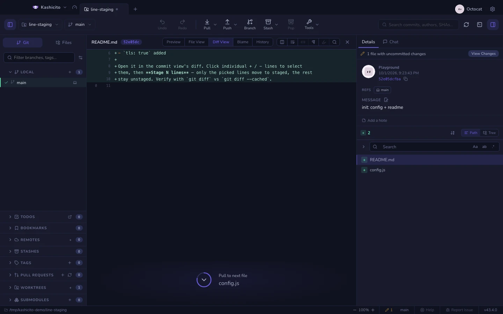

### Hunk headers

Each hunk opens with a header such as `@@ -396,7 +396,7 @@ if barstate.islast`.
The numbers say where the hunk sits: it starts at line 396, and 7 lines are
shown on each side. The text after them is the code git found enclosing the
change, usually the function or block it belongs to. Git guesses it from the
indentation and keywords, so in some languages it is the nearest line that
merely looks like a heading. To show only the line numbers, turn off **Code
context in hunk headers** in Settings → Files & diffs.

Above every diff sits the [semantic summary](semantic-diff.md) — what changed,
symbol by symbol, rather than line by line.

## Image diffs

Changed images get a real comparison: side by side, or a swipe handle to drag
between before and after.

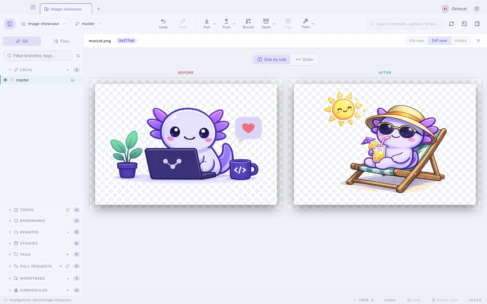

## Change gutter & minimap

The **File view** of a working-tree file — staged or not, tracked or brand new
— carries a colored bar next to every line touched since HEAD (or the index,
for staged files): green for an insertion, blue for a modification, a small
red wedge where lines were removed without replacement. Click a bar to see
that change without leaving the file — the popup shows the removed and added
lines, with next/previous to step through every change in the file.

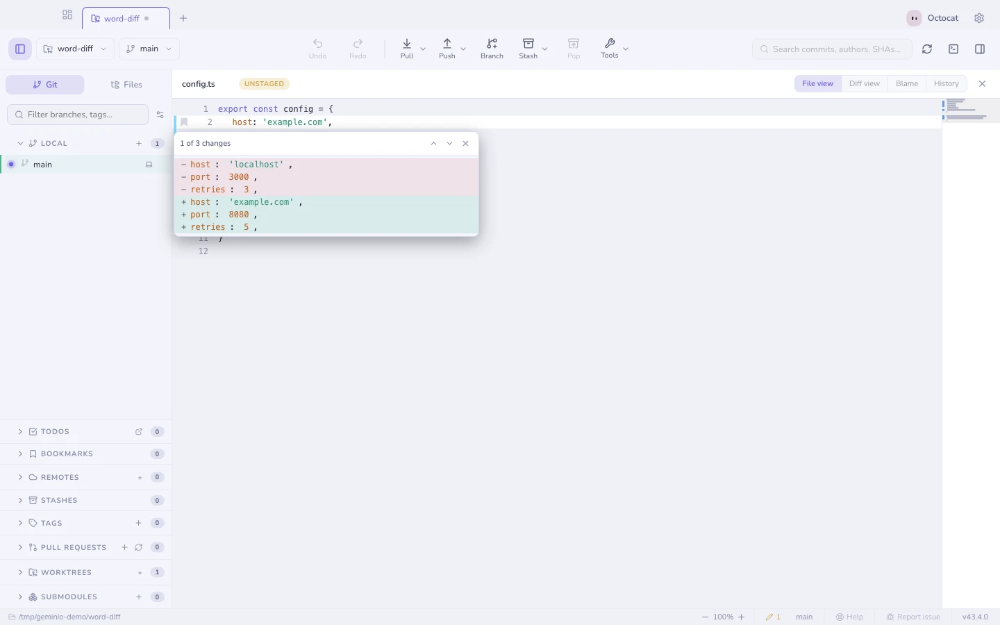

The **minimap**, off by default, adds a scaled overview of the whole file at
the right edge — click or drag it to jump around, the way a scrollbar would if
it could also show you the shape of the file. Both are per-machine toggles
under **Settings → Files & diffs → File viewer**.

Neither reads history: switch to Diff, Blame or an older commit and the gutter
disappears — those views already show every change directly.

## Preview anything

The **Preview** mode renders the file instead of showing its source: Markdown,
Word (`.docx`), Excel (`.xlsx`), PDF, video, audio, images, and
syntax-highlighted code for everything else.

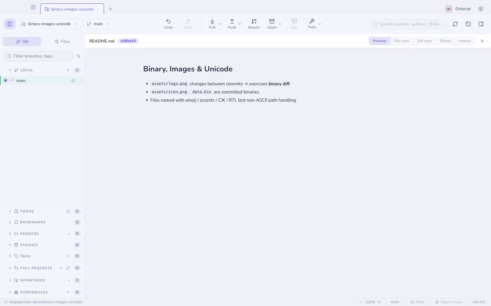

### Apple property lists

`Info.plist` and `*.entitlements` are XML, and XML is not what anyone is trying
to read. Preview shows the key/value outline instead — the shape Xcode's own
plist editor shows — with the nesting intact and each value's type beside it.

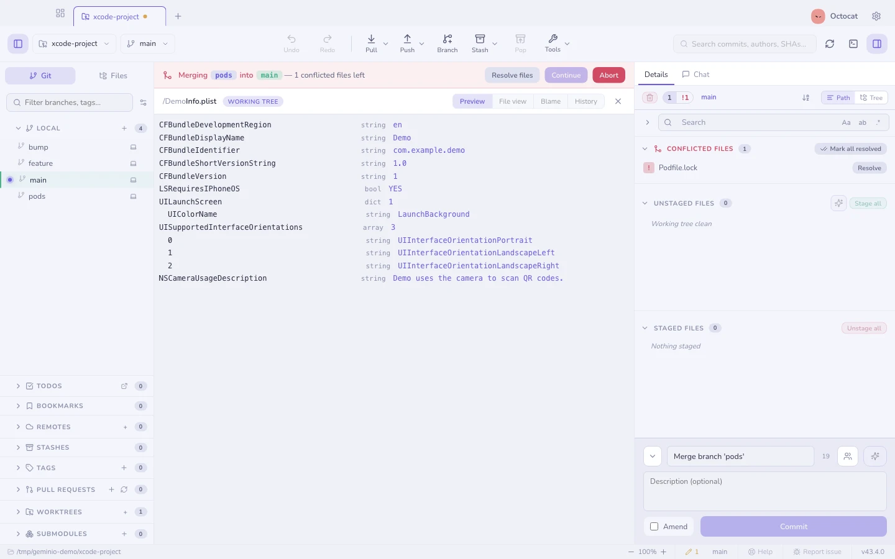

Two limits. A **binary** plist (`bplist00`) is recognised and named, not decoded
— run `plutil -convert xml1` on it if you want it here, though a binary plist in
a repository is usually a build artefact that should not be committed. And
`<data>` values are shown as a byte count rather than as base64: a blob tells
you nothing, and a provisioning profile rendered into a pane you might be
sharing tells everyone else too much.

### Xcode projects

A `project.pbxproj` is one flat dictionary of objects that point at each other
by id, so reading it in order tells you almost nothing about the project. The
preview walks those references and rebuilds the three things you actually came
for: the **targets** with their build phases, the **group tree** as the Xcode
navigator draws it, and the **build settings** per configuration.

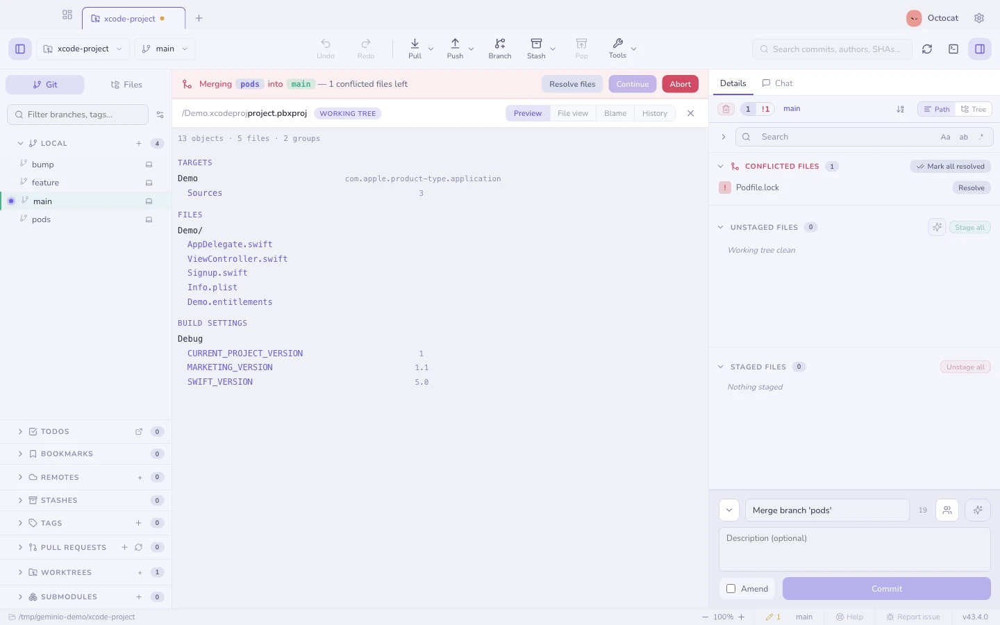

It is a reader, not an editor — nothing here writes to the project. For what
happens when two branches both edit one, see
[resolving conflicts](conflicts.md).

## Very large files

Previews and the file view load a file fully into memory, so both refuse files
past a size cap (32 MB for previews, 16 MB for text) and tell you how big the
file is instead. **Load anyway** overrides the cap for that one file — nothing
is off limits, big loads are just opt-in. Files and diffs past a few thousand
lines still render completely, but rows scrolled out of view are no longer
laid out and painted, so a giant lockfile diff stops costing a laptop's worth
of memory.

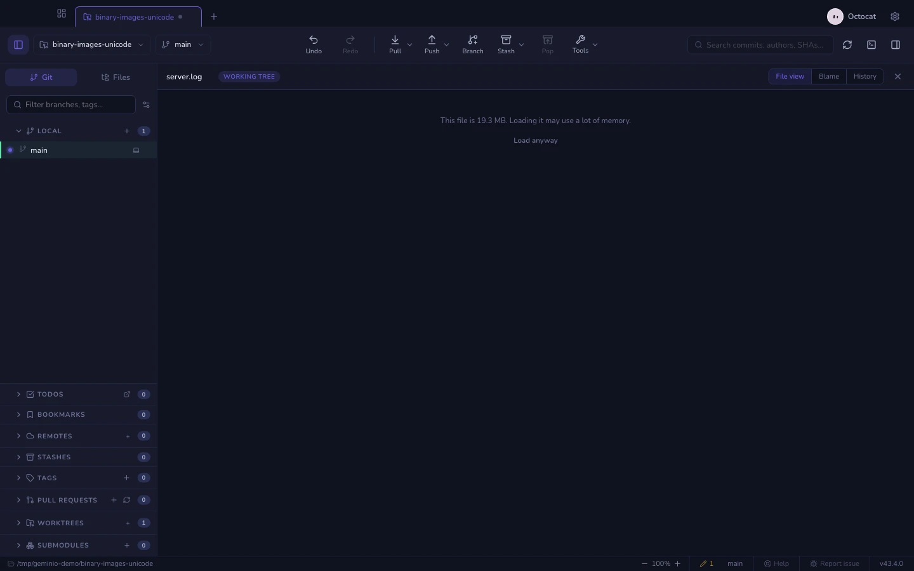

## Files tab

The left sidebar's **Files** tab browses the working tree itself, with status
badges on folders (added / modified / deleted) that aggregate what is inside
them.

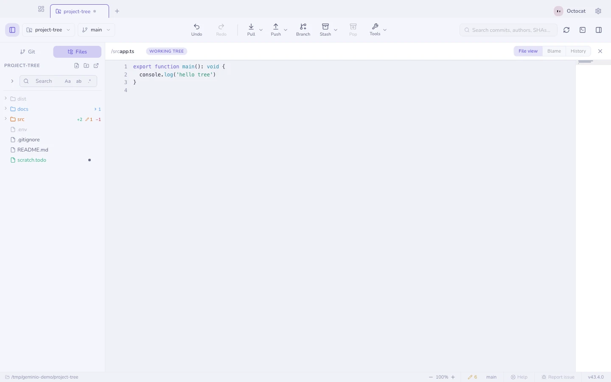

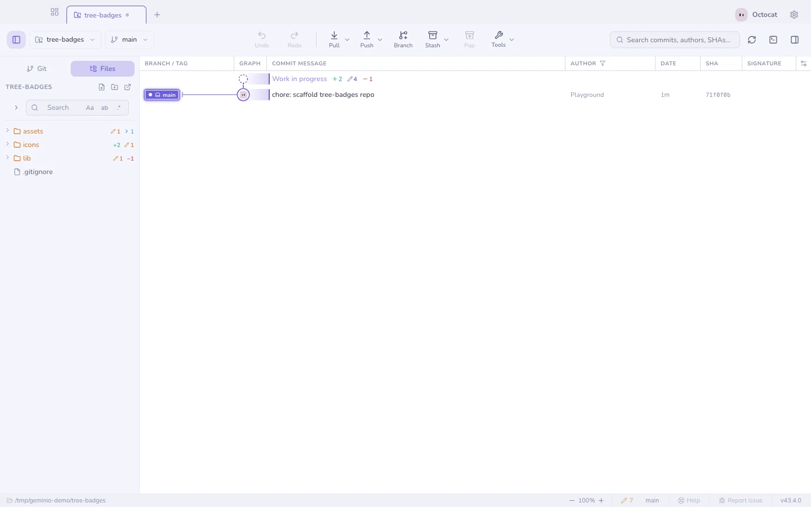

**See also:** [Semantic diff](semantic-diff.md) · [Staging](staging.md)
