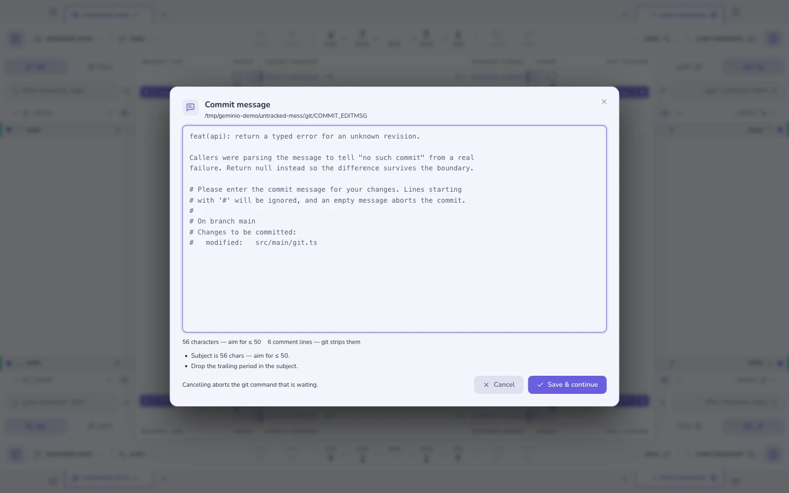

# La línea de comandos

Desde una terminal se hacen dos tipos de pregunta, y `geminio` responde a las dos.

La primera es *«enséñame esto»* — estás en un clon, algo necesita mirarse y la
app es el sitio adecuado para mirarlo. Esas invocaciones abren una ventana, lo
más cerca posible de aquello por lo que preguntaste.

La segunda es *«dímelo ya»* — un hook, un trabajo de CI, o tú, en mitad de una
tubería, queriendo una respuesta y un código de salida en vez de una ventana.
Esas nunca lanzan la app: escriben en stdout y se apartan.

```sh
geminio .                        # abre esta carpeta
geminio blame src/api.ts -l 84   # …en el blame de esa línea
geminio doctor                   # sin ventana: revisa el repo, sale con 1 si falla
```

## Instalarlo

Paleta de comandos (<kbd>⌘K</kbd>) → **Instalar el comando 'geminio' en el
PATH**. En macOS crea un enlace simbólico a un pequeño shim en `/usr/local/bin`
o `/opt/homebrew/bin`, y solo pide permisos de administrador si ninguno de los
dos es escribible por ti. En Linux va a `~/.local/bin`, que no necesita permiso
alguno. Ejecuta el mismo comando otra vez para desinstalarlo. Windows todavía no
está soportado.

Después, si quieres:

```sh
geminio completions zsh >> ~/.zshrc     # o bash, o fish
```

## Abrir cosas

| Comando | Abre |
|---------|------|
| `geminio [ruta]` | El repositorio (por defecto, la carpeta actual) |
| `geminio open <nombre>` | Un repositorio por el **nombre de su pestaña** — `geminio open api` |
| `geminio diff` | Los cambios sin confirmar |
| `geminio graph` | El grafo de commits |
| `geminio show <ref>` | Un commit — `HEAD~2`, una etiqueta, un hash corto |
| `geminio blame <archivo>` | El blame de un archivo; añade `-l 84` para caer en una línea |
| `geminio search <consulta>` | La búsqueda de código, con la consulta ya escrita |
| `geminio stack`, `stash`, `reflog`, `conflicts`, `todos`, `chat`, `settings` | Ese panel |
| `geminio ci`, `clean`, `bisect`, `absorb`, `snapshots`, `insights`, `terminal` | …y así |

`geminio help verbs` imprime la lista completa. Tres opciones valen para todos:
`-n <nombre>` fija el nombre visible de la pestaña, `-g <grupo>` lo mete en una
pestaña de grupo (creándola si hace falta) y `-l <n>` elige una línea.

Geminio es de **instancia única**: ejecutar `geminio` con la app abierta entrega
la petición a esa ventana en lugar de lanzar una segunda copia. Una ruta que ya
está abierta — como pestaña o dentro de un grupo — recibe **el foco**, no un
duplicado. Una carpeta que no es un repositorio se abre igualmente, ofreciendo
el flujo de «inicializar repositorio aquí».

## Responder en la terminal

Estos imprimen y terminan. No abren ventana, y la app ni siquiera necesita estar
en marcha.

### `geminio status`

Rama, seguimiento, adelanto/retraso, árbol de trabajo, stashes y — si el
repositorio la trae — la [lista de comprobación de push de
`.geminio.json`](repo-config.md). Sale con 1 cuando el árbol de trabajo tiene
conflictos, así que `geminio status || echo bloqueado` funciona.

### `geminio doctor [--fix]`

Ejecuta las mismas comprobaciones que el panel de [configuración del
repositorio](repo-config.md): la versión de Node, los submódulos, LFS,
`core.hooksPath`, los archivos requeridos. **Sale con 1 si alguna falla**, que es
el sentido de todo esto — las reglas que un repositorio declara valen poco si
solo las ve quien tiene la interfaz abierta:

```yaml
- run: geminio doctor          # en CI, antes de nada caro
```

`--fix` aplica las reparaciones que el doctor sabe hacer (inicializar
submódulos, `lfs pull`, fijar `core.hooksPath`, copiar un archivo desde su
ejemplo) y vuelve a comprobar. Nunca ejecuta un comando que venga del archivo de
configuración: el conjunto de reparaciones es cerrado.

Los avisos no hacen fallar la ejecución. Un aviso significa que el doctor no
pudo determinar algo, no que algo esté mal, y hacer fallar compilaciones por eso
haría el archivo demasiado caro de adoptar.

### `geminio commit-check [archivo]`

Revisa un mensaje de commit. Sin argumento lee `.git/COMMIT_EDITMSG`; `-m "…"`
revisa una cadena. Sabe lo que declaró el repositorio: un scope desconocido es
un **error** cuando `.geminio.json` lista scopes, y solo un consejo de estilo
cuando no. Engánchalo a un hook:

```sh
# .husky/commit-msg
geminio commit-check "$1"
```

### `geminio config init | show | check`

`init` lee el repositorio y propone un `.geminio.json` a partir de lo que ya
hay: `.nvmrc`, `.gitmodules`, un `.env.example` sin `.env`, los scopes de commit
que el historial viene usando. `--dry-run` imprime en vez de escribir. `show`
imprime el archivo actual; `check` lo valida y lista cualquier campo que se
descartaría.

### `geminio repos [filtro]`

Todos los repositorios que Geminio conoce — primero las pestañas abiertas,
luego los recientes — con su grupo. `--paths` imprime rutas desnudas, una por
línea, para scripts:

```sh
cd "$(geminio repos --paths api | head -1)"
```

## Geminio como editor de git

```sh
geminio editor install
```

fija `core.editor` y `sequence.editor` a `geminio --wait`. A partir de ahí
`git commit` (sin `-m`), `git commit --amend`, `git tag -a` y `git rebase -i`
abren su archivo en Geminio en lugar de vim, con un contador de caracteres y las
mismas pistas de mensaje que muestra el compositor.



Lo importante es la palabra **esperando**: git está bloqueado en ese diálogo. Así
que

- **Guardar y continuar** reescribe el archivo y git sigue adelante.
- **Cancelar** escribe un archivo vacío, que git lee como *abortar*.
- Cerrar el diálogo de cualquier otra forma — Escape, el fondo, salir de
  Geminio — cuenta como Cancelar. Una terminal esperando para siempre sería
  mucho peor que un commit que hay que reescribir.

Añade `--local` para limitarlo a un repositorio, y deshazlo con
`geminio editor uninstall`.

## Lo que no hará

- **Ningún verbo de terminal modifica el repositorio.** `doctor --fix` es la
  única excepción, y sus reparaciones son una lista fija, no algo que un archivo
  de configuración pueda ampliar.
- **`repos` es de solo lectura.** La app en marcha es dueña de su archivo de
  ajustes; la CLI lo lee y nunca lo escribe.
- **Un verbo que la app instalada no conoce se ignora**, no se rechaza: un shim
  más nuevo contra una app más vieja sigue abriendo el repositorio.
- **Windows todavía no tiene shim.** Los verbos están todos implementados; solo
  falta la instalación.

**Véase también:** [Espacios de trabajo, pestañas y grupos](workspaces.md) ·
[Configuración del repositorio](repo-config.md) · [Confirmar cambios](committing.md)
