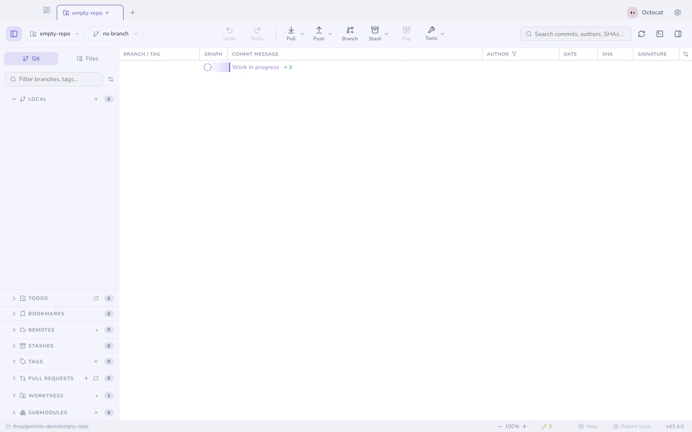
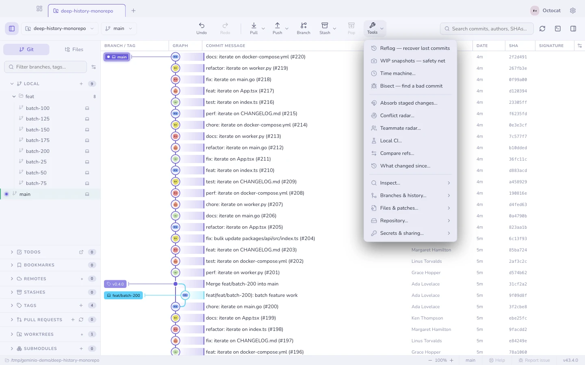

# Getting started

Geminio is Kash's desktop Git client. Open a folder to explore its history,
review changes and work with your GitHub account.

## Open a repository

- **Drag a folder** onto the window, or use **Open repository** on the welcome
  screen.
- **Clone** one from a URL or straight from your host — see [cloning](cloning.md)
  for the options that make a huge repository quick to clone.
- From a terminal, `geminio .` opens the current folder in the running app —
  see [the command line](cli.md).
- A folder that is not a Git repository yet still opens, offering to
  initialise it.

## The three panes

| Pane | What it holds |
|---|---|
| Left | Branches, remotes, tags, stashes, worktrees — and the **Files** tab for the working tree |
| Middle | The commit graph, and whatever you select from it |
| Right | The commit composer, or the details of the selected commit |

## Set up your workspace

Use the **Settings** gear in the title bar for appearance, integrations and
other preferences. **Repository** inside the same window holds settings for
the current repository. Connect GitHub under **Integrations**; an existing
GitHub CLI login can be reused.

Column order, widths and visibility, plus sidebar section arrangement, are
shared across repositories. Right-click a graph header to choose columns, and
drag the divider above the commit message to resize its section. The Pull
button's dropdown chooses whether its main action fetches or pulls.

## Finding everything else

Two routes, and they lead to the same places:

- **`⌘K`** (`Ctrl+K`) — the command palette. Type what you want; it also jumps to
  branches, commits and files.
- **Tools** in the toolbar — the same repository-scoped set as a menu, with the
  long tail folded into groups so it stays readable.

When the window gets narrow the action bar stops competing for space: the buttons that no longer fit fold into a **More** dropdown at its end, in bar order and with their own submenus intact. Widen the window and they come back out.

Anything reachable by one is reachable by the other, so there is nothing that
only power users can find.

## Your first commit

1. Edit a file. It appears under **Unstaged**.
2. Stage it — the whole file, a hunk, or [single lines](staging.md).
3. Write a message and press **Commit**.

Everything else in Geminio is optional.

