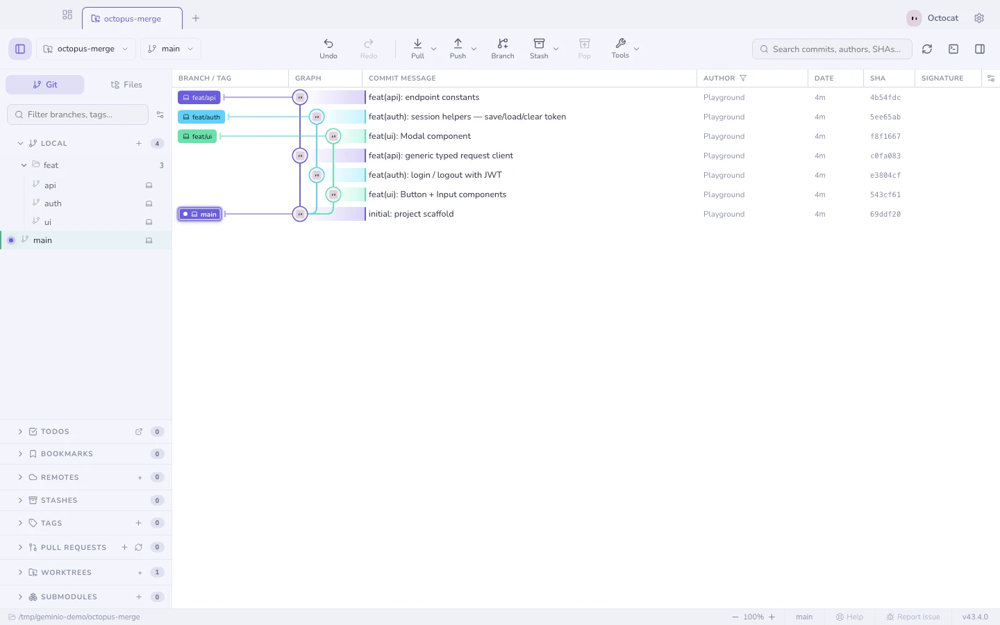
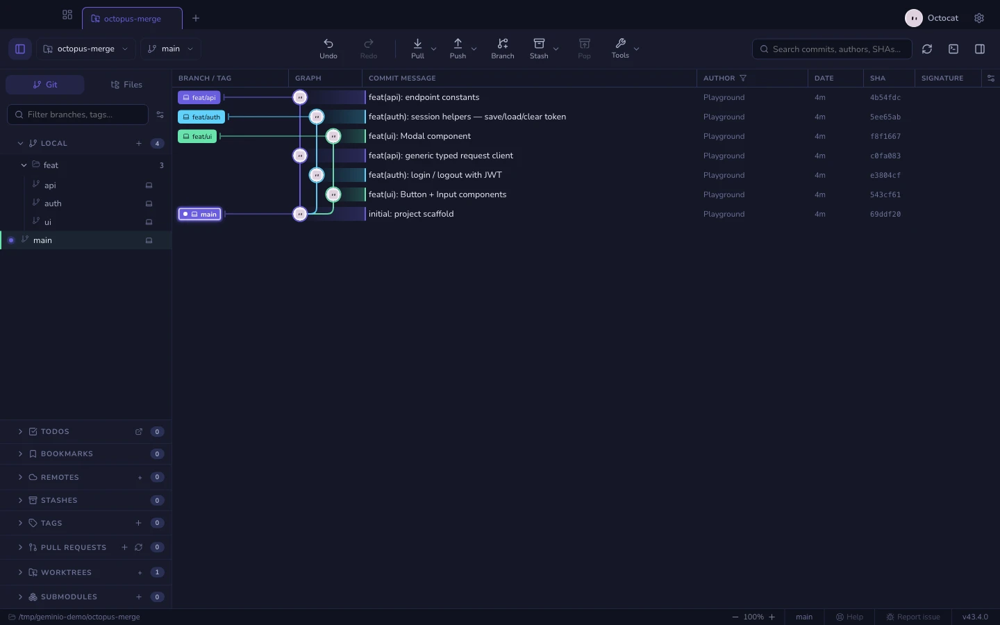
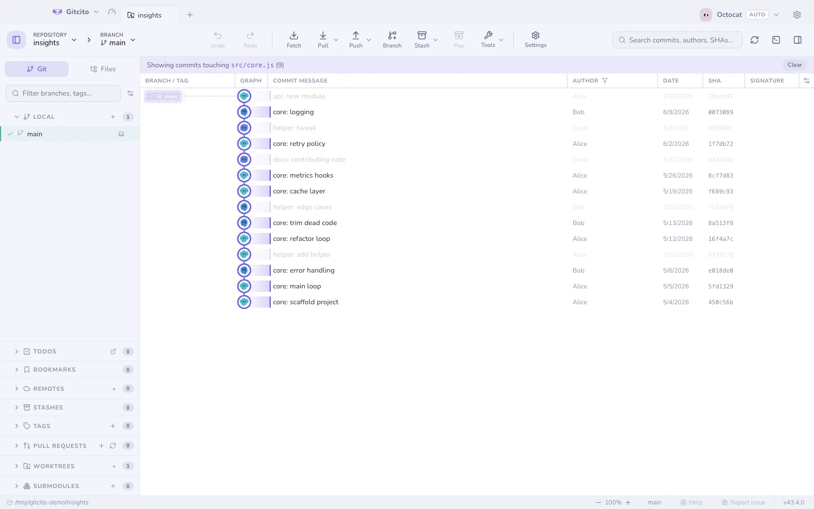
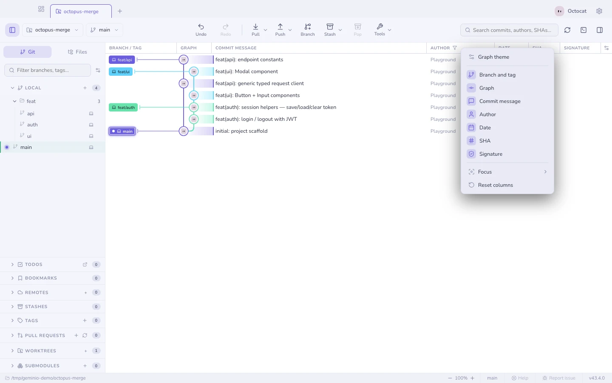
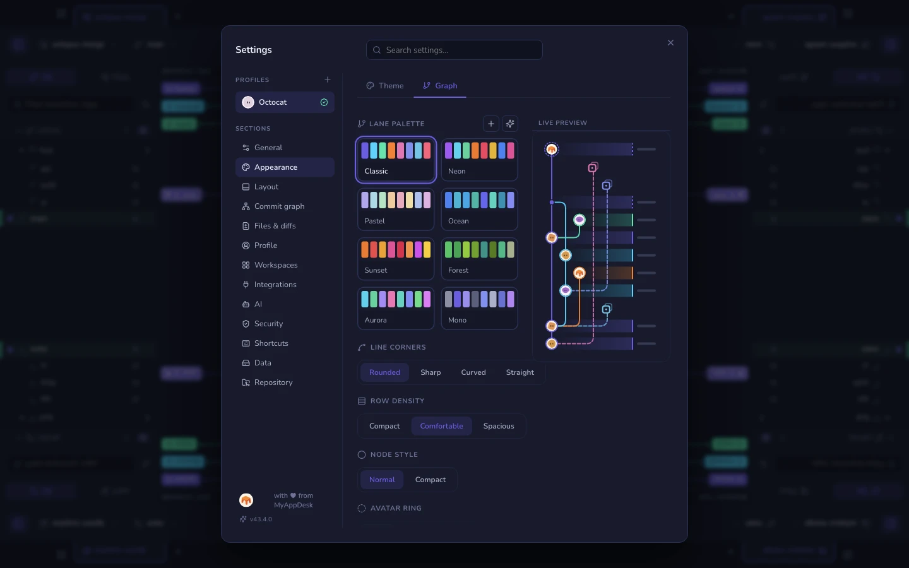
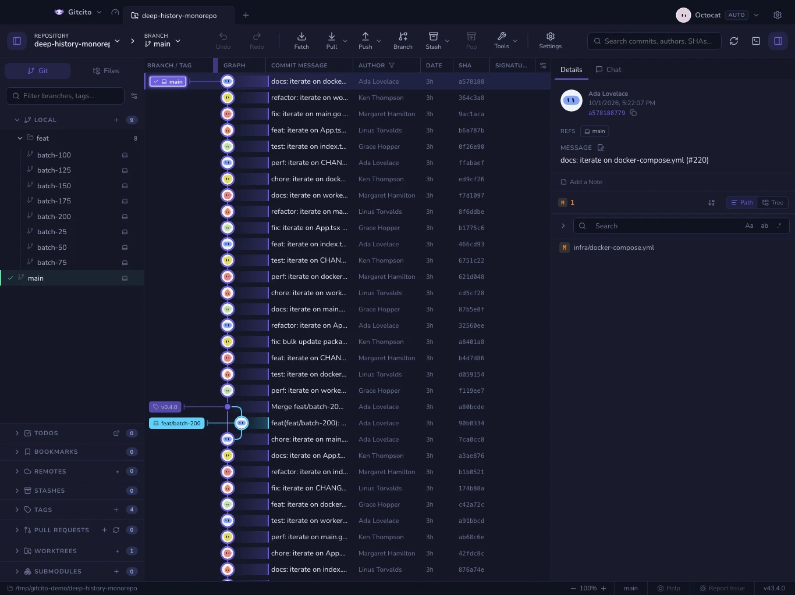
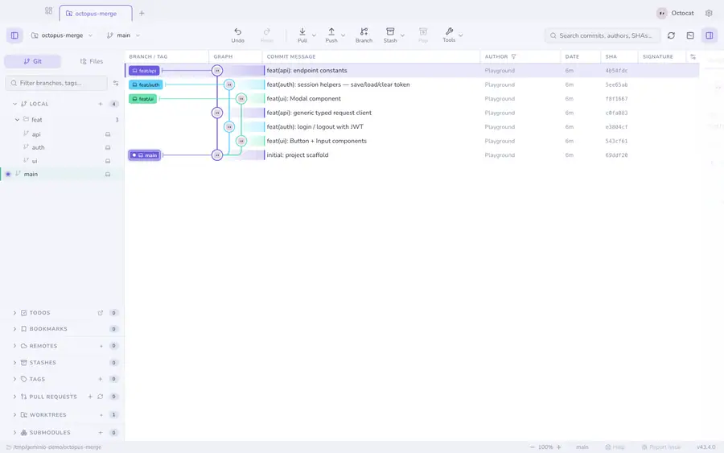

# The commit graph

Branches, merges and octopus merges drawn properly, in light or dark. Rendering
is windowed, so a repository with a hundred thousand commits scrolls like one
with a hundred.

| | |
|---|---|
|  |  |

## Moving around

- <kbd>↑</kbd> <kbd>↓</kbd> (or <kbd>j</kbd> <kbd>k</kbd>) walk the selection.
- <kbd>⌘</kbd>/<kbd>Ctrl</kbd>-click toggles a commit into a **multi-selection**;
  <kbd>⇧</kbd>-click takes a range. With several selected, right-click to
  cherry-pick them onto the current branch, squash a contiguous run, export one
  combined patch, or copy their SHAs.
- Commits that arrived in your **last fetch or pull** are flagged as new. Ones
  that have not joined the checked-out branch yet stay slightly translucent
  until a pull brings them in.
- Right-click a commit for **Amend**, **Undo**, **Reset to commit…** and
  **View on GitHub**, plus checkout, cherry-pick, revert, branch, tag and
  copy. Unsafe actions stay visible and disable.
- **On GitHub.** In the details panel the short hash under the author is a
  link to the commit on GitHub, and the GitHub button beside **Copy** opens the
  same page. Right-click a branch badge in the graph, a branch in the sidebar,
  or the branch picker in the toolbar for **View on GitHub**. A local branch
  goes through its upstream. All of these stay disabled, with the reason on
  hover, until the commit or branch has been pushed. GitHub has no page for
  something that only exists on your machine. Links use `origin` when it is on
  GitHub, otherwise the first GitHub remote. Other hosts are not linked.

## Making it show what you want

- **Graph focus** decides how much history is drawn — Settings → Appearance →
  **Graph**, or the gear menu in the graph header. *Everything* draws it all;
  *Linear history* (first-parent) leaves only the trunk; *Hide merged branches*
  keeps the trunk plus the branches that are still unmerged; *Solo* keeps your
  branch, your starred branches and the default branch.

  It filters only what the log has already loaded. *Hide merged branches* trusts
  git's own "already contained in the current branch" answer, so checking out a
  different branch changes what it hides — and it keeps every commit a tag or an
  unrecognised ref still points at, which is exactly what a deleted branch leaves
  behind. *Linear history* and *Solo* are blunter: a tag or a stash sitting on a
  commit they drop goes with it.

- **Filter by path**: right-click a file or folder → *Filter graph by this
  path*, and only the commits that touched it stay lit.

- **Columns**: show, hide, resize and reorder branch, message, author, date,
  SHA, signature and deployment columns. Right-click any column header to
  open the same column menu as the icon at the right. Click a column to show
  or hide it; a shown column's icon is lit, and the menu stays open so you can
  change several at once. Order, widths and visibility apply across all your
  repositories. **Double-click a column edge** to fit
  all columns to the widest content in the loaded history, including rows
  outside the viewport. Each fitted column uses at most 35% of the graph,
  within its minimum and maximum widths. The message fills what is left,
  and the graph column goes back to fitting its lanes. Each column has a maximum, so the
  table never scrolls sideways into empty space; when a narrow window does make
  it scroll, the headings move with the rows.

- **Dates**: *Date format in the graph* (Settings) picks Relative ("3d"), Date
  & time ("15 Sep 2026, 17:22") or ISO ("2026-09-15 17:22"). With relative
  dates, the row under the pointer shows its exact date and time in place.
- **Descriptions**: *Commit descriptions in the graph* (Settings → Graph) shows
  the start of each commit's description after its title, in a quieter shade.
  Trailers such as `Co-authored-by:` are left out, and only the first 160
  characters are loaded, so large repositories stay fast.
- **Style**: Settings → Appearance → **Graph** — lane palette (8 built-ins, custom,
  or AI-generated), corner style, row density and line thickness, with a live
  mini-graph preview.

## Where stashes sit

A stash is drawn as its own row, hanging off the commit it was taken from on a
dashed spur so it never displaces the trunk. It is placed in the row **directly
above that parent commit**, not in the slot its own timestamp would earn it.

Its marker is an archive box in a dotted frame — the same archive symbol the
stash list, command palette and details header use, so the graph names a stash
the way the rest of the app does. The dotted frame is what separates it from a
commit: sitting one row above its parent, shape has to carry "this is not part
of the branch".

A stash is nearly always newer than the commit it sits on, so ordering by date
would float it up among unrelated commits and stretch its tether across half the
graph. The parent is the only row a stash actually relates to, so that is the one
it stays next to.

The limit: a stash whose parent commit is not in the loaded window — pruned, or
scrolled past the end of the log — has nothing to anchor to, and falls back to
date order until its parent loads. The *Linear history* and *Solo* focus modes
drop a stash whose parent they drop, as noted above.

## Commit details

Selecting a commit shows its changed files (tree or flat), author, SHA,
co-authors, and its signature. The header above the file list splits the
count by kind, coloured like the glyphs on the rows. `#123` references and
`@mentions` are autolinked to your host.

The counts read like `git diff --stat`: `~7 +3 −1` for modified, added and
deleted, `→` for renamed, `!` for conflicted — drawn as one capsule, or as
loose numbers (Settings → Files & diffs → **Change counts**).

Those counts are also the list's filter. Click one (say **+3**) to show only
added files; click it again, the total at the start of the counts, or press <kbd>Esc</kbd>
to see everything. Hold
<kbd>⌘</kbd>/<kbd>Ctrl</kbd> while clicking to combine kinds, such as added
and deleted. The other counts dim while a filter is on. The filter stays as
you move between commits, and steps aside on a commit that has none of that
kind rather than showing an empty list. Stash details and the working
changes panel work the same way.

The file list multi-selects with the usual gestures
(<kbd>⌘</kbd>/<kbd>Ctrl</kbd>-click, <kbd>⇧</kbd>-click,
<kbd>⇧</kbd>+<kbd>↑</kbd>/<kbd>↓</kbd>). Right-click the selection → *Restore
{n} files to working tree* takes those files exactly as this commit had them:
after one confirmation it overwrites the working copies, and touches neither
HEAD nor the index.

**See also:** [Blame & file history](blame.md) · [Search](search.md) · [Time machine](time-machine.md) · [Author avatars](avatars.md)
