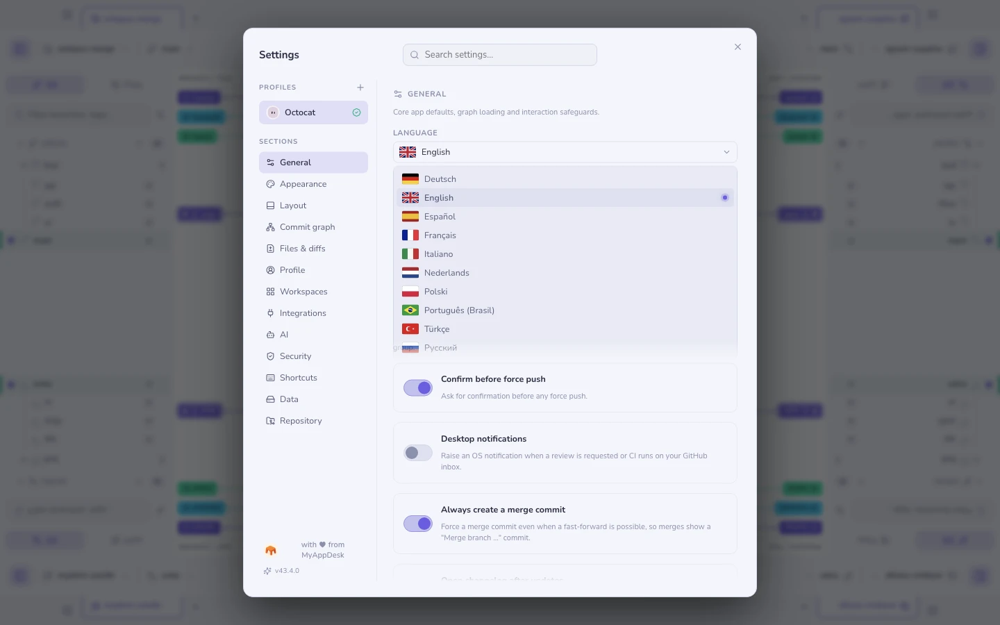
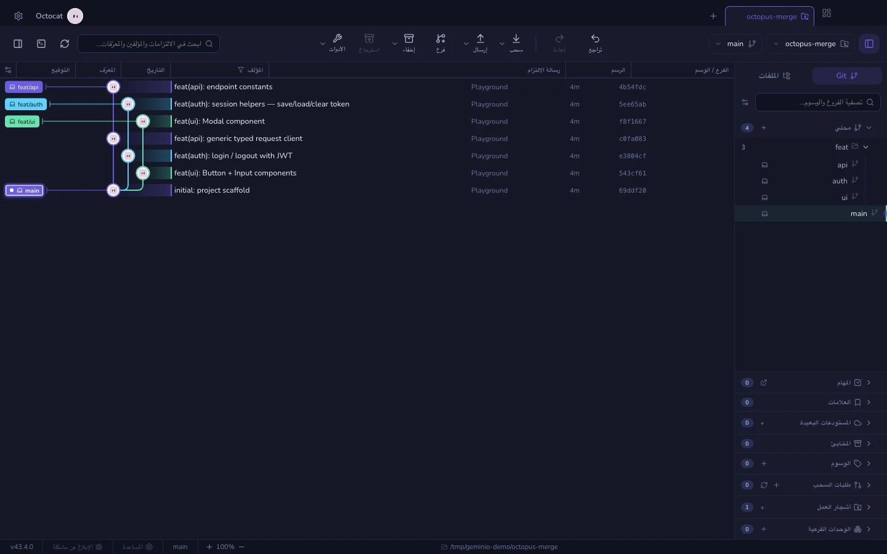

# Languages & right-to-left

Geminio's interface is translated. The language is a
Geminio setting, not an OS one — a developer on an English macOS install who
would rather read Japanese sets it here, and a developer on a Hebrew system who
prefers the app in English is not overruled.

**Settings → General → Language.**

## What ships

| | | | |
|---|---|---|---|
| English | Español | Deutsch | Français |
| Português (Brasil) | Italiano | Nederlands | Polski |
| Türkçe | Русский | Українська | 简体中文 |
| 日本語 | 한국어 | العربية | עברית |

Each row in the picker is written in its own language. Someone looking for
Korean is scanning for 한국어, not for the word "Korean" in a language they
are trying to leave.

### About the flags

A flag names a country; a locale names a language. The two genuinely do not
line up — Arabic is an official language in more than twenty states, and
Portuguese is on two continents. The icons follow the same convention every
operating system's locale picker uses: the locale's primary region. They are
there to be *recognised at a glance*, not to make a claim about who a language
belongs to.

They are drawn as vector art rather than emoji on purpose. Windows ships no
flag emoji at all — `🇩🇪` renders there as a box containing the letters "DE".

## Right-to-left

Arabic and Hebrew mirror the whole interface: the sidebar moves to the right,
panels and toolbars reverse, icons that point somewhere point the other way.

Switching is immediate and needs no restart.

### What deliberately does not mirror

Some content is left-to-right no matter what language you read. Mirroring it
would be actively wrong, so these stay as they are:

| Stays LTR | Why |
|-----------|-----|
| The commit graph | Lane positions are computed in pixels; a mirrored container would disagree with the drawn lines |
| Diffs and file contents | Code is LTR, and a mirrored diff is unreadable |
| Blame and the conflict output | Same reason — the text is source, not prose |
| The integrated terminal | It renders its own grid; git's output is LTR |
| Paths, SHAs, refs and commands | `refs/heads/main` reads in one direction only |

Each of these is isolated so a run of Arabic *inside* one — a branch name, a
commit message, a filename — cannot reorder the text around it.

### The limits

This is honest about where it stops:

- **Commit messages, branch names and file contents are never re-directed by
  Geminio.** They are shown as their author wrote them. A Hebrew commit message
  in an LTR-isolated list renders as Hebrew, but the surrounding row does not
  flip to accommodate it.
- **Third-party surfaces keep their own direction** — the terminal is xterm,
  and Markdown previews render the document as written.
- **Mixed-direction filenames are hard.** A path with an Arabic folder inside
  an English tree is isolated rather than reordered, which is correct but can
  still look surprising the first time.

## This handbook is in English

The interface follows your language; this handbook does not. Every page is
written in English, in the app and on the website alike.

The reason is accuracy. The handbook changes with every feature, and a
translation that cannot keep the same pace ends up describing an older app — a
confident, well-formatted page about a button that has since moved. One
up-to-date language is more useful than many drifting ones.

*Limit:* a reader who does not read English gets a translated interface and an
English manual. Interface strings added since the fork are English too, until
someone translates them.

## Adding a language

The dictionaries are one file per locale under
`src/renderer/src/i18n/`, and the English file is the reference every other one
is type-checked against: a locale may lack a key, which then shows in English,
but it can never invent one. The test suite also checks that every `{placeholder}` a
string interpolates survives translation, so a sentence cannot lose its commit
sha on the way into another language.

Correcting a clumsy interface translation is as useful as adding a missing
one.

**See also:** [Themes & appearance](themes.md) · [Profiles](profiles.md)
