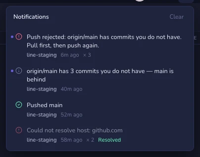

# Notifications

Geminio answers what you do with short messages at the bottom of the window.
They are gone in a few seconds — fine for "pushed", useless for the push that
failed while you were in another app. The **bell** in the title bar keeps what
you would act on and could have missed, and nothing else: a list that fills
with "Fetched origin" every few minutes teaches you to ignore it.

| Kept | Examples |
|------|----------|
| **Failures** — something is blocked until you act | A push rejected or unreachable, a pull stopped on conflicts, sign-in refused, a background fetch failing |
| **News from others** — your situation changed out of sight | A background fetch brought commits your branch does not have; a branch's history was rewritten on the remote |
| **Work done while you were away** | A push, pull or clone you started finished while Geminio was in the background |

**Not kept:** a fetch that found nothing, work you started and watched finish,
local actions (commit, stage, stash, undo), and hints like "Nothing to redo".
Those stay brief messages. A failure you watched happen is kept for the record
but does not light the bell — you have already seen it.

## Knowing something happened

| You see | It means |
|---------|----------|
| A small dot on the bell | News, nothing wrong — commits from others arrived, work finished while you were away |
| A red number on the bell | That many unseen failures — news never adds to it |
| A red number on the Dock icon | The same failures — visible from any other app |

Opening the bell clears both badges. An error raised while Geminio is in the
background also stays on screen until you come back, instead of timing out
unseen.

## The list

Newest first, each with the repository it came from and how long ago. Rows
that arrived since you last looked carry a dot while the list is open. Click a
row to switch to its repository. **Clear** empties the list.

A failure that keeps happening is one row that counts up — five failed fetches
while offline read **× 5**, not five rows. When the same work next succeeds, the
row is marked **Resolved** and stops counting, so a problem that fixed itself
never leaves the bell red. News works the same way: the "behind" row always
shows the current count, not one row per fetch.

The most recent 200 messages are kept, across restarts — so a push that failed
overnight is still there in the morning. Before anything is saved, a password
or token inside a URL is removed from the text.

Your **GitHub inbox**, when GitHub is connected, is the first row of the list;
it opens the inbox page (see [Hosting](hosting.md#notifications--github)). Its
number is GitHub's own unread count, the same as on github.com: it goes down as
you read items, not when you glance at the list. The bell treats GitHub like
everything else — once you have opened the bell or the inbox, those items stop
lighting the dot, and only newer ones do.

## System notifications

**Settings → General → System notifications** decides whether macOS shows a
notification while Geminio is in the background:

| Choice | Notifies you of |
|--------|-----------------|
| **Off** (the default) | Nothing — the Dock icon and the bell only |
| **Errors only** | Anything that fails |
| **Errors and updates** | Failures, new commits from others, and work that finished while you were away |

It is off until you choose, so macOS never asks for permission unprompted.
Clicking a notification brings Geminio forward.

## Limits

- The list is a selection, not a full record. Every git command Geminio ran,
  with its output, is in **Repository settings → History · Logs**.
- "Behind" news comes from fetches — the background fetch (**Settings → General
  → Auto-fetch**) or one that finished while you were away. With auto-fetch
  off, nothing arrives on its own.
- It is kept per machine, not synced between computers.
- System notifications follow macOS's own settings — Focus modes and
  **System Settings → Notifications** can silence them.
