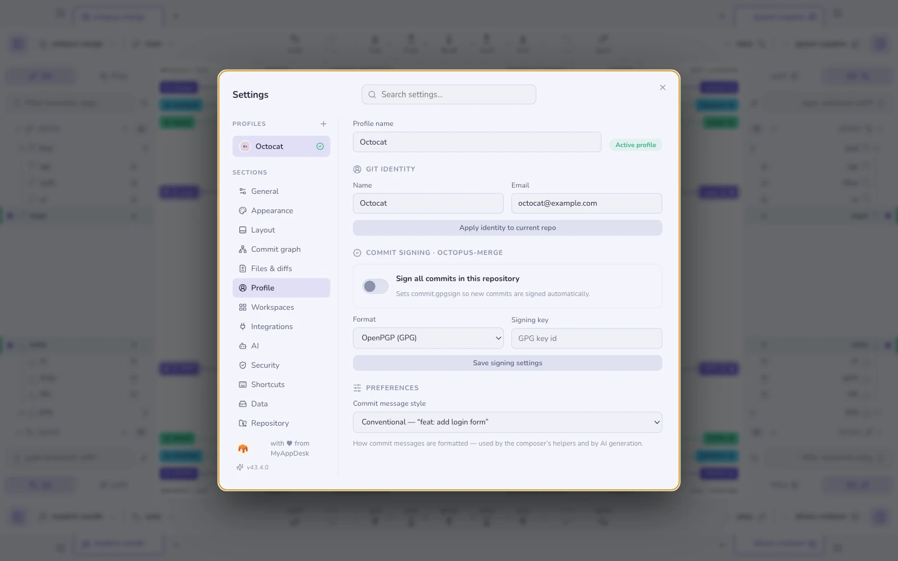

# Profiles

A profile bundles a **Git Identity** (name and email) with its **integration
tokens**. Switch profiles and both change together — commits are authored
correctly and API calls use the right account.

Useful when the same machine does work and personal repositories, or when you
have two GitHub accounts.

The active profile's connected GitHub photo appears in the title bar and
Settings, even when the profile has no explicit Git email. The title bar is
an account indicator; profile management lives in Settings.

## Per-repository binding

A repository can be **bound to a profile**, so a background fetch on it always
authenticates as the right account — even while you are looking at a repository
that belongs to the other one.

Tokens live in your [OS keychain](security.md), never in the settings file.

**See also:** [Security & secrets](security.md) · [Hosting](hosting.md)
