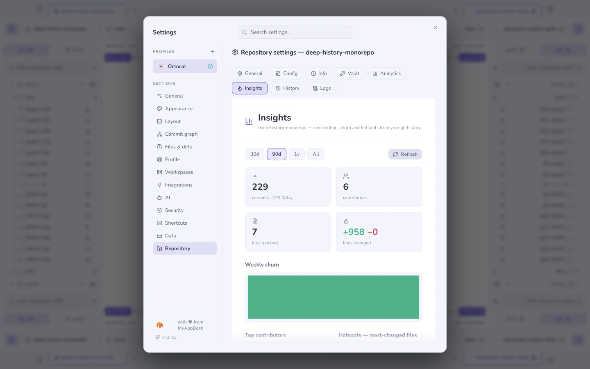

# Per-repository settings

Open the title-bar **Settings** gear, then choose **Repository** in the same
window used for appearance and other app preferences. The repository name
above the tabs identifies which repository these controls affect.

Menus close when you click outside them. Settings also closes on a backdrop
click, unless a repository config, info or vault editor has unsaved changes.

| Tab | What it holds |
|---|---|
| **General** | Protected branches (a branch multi-select, stored in git config), signing |
| **Config** | The [rules this repository ships](repo-config.md) in `.geminio.json`, and the doctor that checks them |
| **Info** | Free-form notes and fields about this repository, kept locally |
| **Vault** | This repository's [vault](vault.md) entries |
| **Insights** | The [history dashboard](insights.md) |
| **Analytics** | What you have done in this repository, counted locally |
| **History** · **Logs** | The operation log: every git command Geminio ran, with its output |

The operation log is the honest one: when something behaves oddly, it shows the
exact command and the exact error, so a bug report can carry facts rather than
adjectives.

**See also:** [Repository rules](repo-config.md) · [Security & secrets](security.md) ·
[Insights](insights.md)
