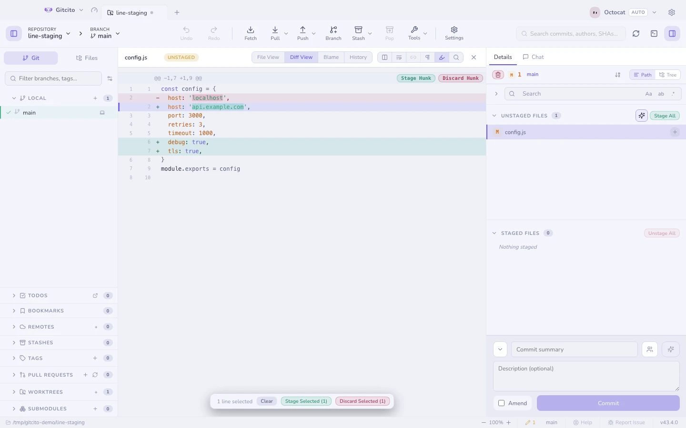
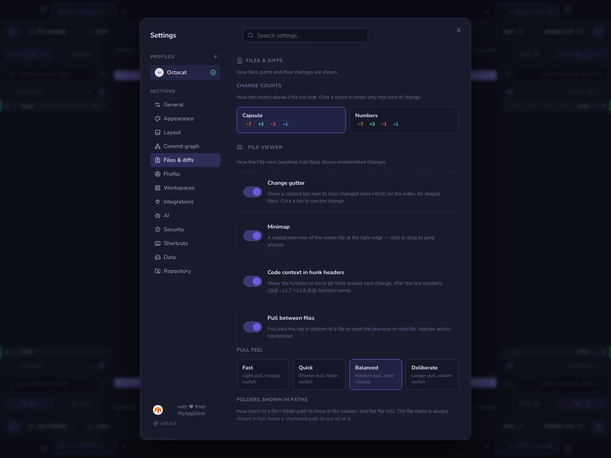

# Staging

The commit panel has three lists: **Conflicted**, **Unstaged** and **Staged**.
Each collapses, and each remembers whether you left it open.

## Knowing there are changes

While you look at a commit or a stash, a banner at the top of the details panel
says how many files have uncommitted changes, with **View changes** to go to
them. The status bar shows the same count as a small ✎ next to the branch name,
in every view. Both are hidden when the tree is clean, and both stay visible
with a file open over the graph, which hides the WIP row.

## What changed, by kind

The header above the lists splits the count the way the file rows already
do: the same status tiles (M, +, −, →, !), a number, and a short bar for the
mix. A kind with nothing in it is simply absent, not shown as zero. Hover for
the plain total.

Untracked files count as added. That is the one place staging's summary
disagrees with a commit's, because a commit has no untracked files.

## Path, tree, and order

**Path** lists every file on one line with its full path; **Tree** folds them
into folders. The **A→Z** button beside them sorts the path list
alphabetically, ignoring case, with `file2` before `file10`. Off, the list
keeps git's own order, which is by byte value, so `Zeta.md` comes before
`alpha.ts`. The tree is always sorted by name, so the button is greyed out
there. The choice applies to every file list (staging, commit details and
stashes) and is remembered.

In commit details and stashes the same two choices are also on a file's
right-click menu, under **View as** and **Sort by**. The staging list leaves
them to its header, which is right there, to keep its menu short.

The counts in the header (modified, added, deleted…) filter the lists: click
one to show only that kind across conflicted, unstaged and staged files, click
it again to show everything. See [Commit details](graph.md#commit-details).

Deep paths never push the file name off the row. When space runs out, folders
give way from the left (`…/code/indicator/revelio.pine`). To keep paths short
even when there is room, set **Folders shown in paths** in Settings →
Files & diffs: all of them, the last three, two or one, or none at all. A
shortened path starts with `…/`, and hovering it shows the whole path.

## Three levels of precision

| Level | How |
|---|---|
| **File** | Click the ✚ on the row, or select several rows and stage the lot |
| **Hunk** | Open the diff and use the button on the hunk header |
| **Line** | Click lines inside the diff to select them, then act on exactly those |

Line staging is what makes it practical to keep a debug `console.log` out of a
commit without deleting it first.

## Hunk and line actions

What the buttons on a hunk (and on a line selection) do depends on the diff you
are looking at:

| Diff | Actions | What happens |
|---|---|---|
| Unstaged changes | **Stage hunk**, **Discard hunk** | Stage copies the change into the index. Discard puts the lines back as they are staged (or committed) |
| Staged changes | **Unstage hunk** | Takes the change out of the index. The file on disk is untouched |
| A commit | **Revert hunk** | Undoes that part of the commit in your working tree, as an uncommitted change. No commit is made |
| A stash | **Apply hunk** | Brings just that part of the stash into your working tree. The stash is kept |

**Right-click a line** for the same actions without selecting first: *Stage
this line* or *Discard this line* (or Unstage, Revert, Apply, depending on the
diff), the whole hunk, and *Copy line*. Right-click a line that is part of a
selection and the menu acts on the whole selection instead ("Stage selected
(3)"). With text highlighted in the diff, *Copy* copies just that text. In the
inline layout a row is a line's old and new version together, so *this line*
means both halves of the edit.

Every one of them can be undone. Discard asks first, because the lines it throws
away exist nowhere else; before it (and before revert and apply) Geminio also
takes a [WIP snapshot](recovery.md).

The limits:

- **With whitespace ignored**, the actions do what the visible diff shows. A
  whitespace-only change hidden from that view is left exactly where it is, so
  staging a hunk does not also stage a re-indent you could not see.
- **When the file has moved on.** Revert and apply cut their patch from history,
  and the file may have changed since, through a later commit or edits you have
  not committed. Geminio then merges the hunk in three ways, the way git merges
  a whole commit. Changes that do not overlap combine cleanly. Lines you have
  edited yourself get conflict markers (`<<<<<<< working copy` … `>>>>>>> hunk`)
  and a notice says so. The result is an unstaged change, never staged, so you
  review it before it goes anywhere. If git no longer has the version the hunk
  came from, or the hunk is already undone, nothing changes and you are told so.
- **Line selection works in both views.** Click changed lines in unified or
  split view; one selection carries across if you switch.
- **New untracked files** have no hunks to pick from. Stage or discard the whole
  file. (A stash's untracked files are the exception: Apply hunk creates them.)
- **Conflicted files** show git's combined diff, which hunk actions cannot
  read. Resolve them in the conflict view.

## Discarding

Discard works at the same levels, and always asks. Untracked files are deleted;
tracked ones go back to their staged (or committed) state. The right-click
entry names what it discards ("Discard changes to kash-os.pine", or "… to 3
files" for a selection), so it never reads as discarding everything.

To throw away everything at once, staged and unstaged, use the red trash
button at the top-left of the changes panel (**Discard all changes**). It asks
first, and the files it removes are not recoverable from git.

## Keyboard

<kbd>↑</kbd> <kbd>↓</kbd> (or <kbd>j</kbd> <kbd>k</kbd>) walk the file lists.
<kbd>⇧</kbd>+<kbd>↑</kbd>/<kbd>↓</kbd> grows a selection from the last row you
clicked, <kbd>⇧</kbd>-click takes a range, and <kbd>⌘</kbd>/<kbd>Ctrl</kbd>-click
toggles individual files. Right-click the selection to stage, unstage, stash or
discard everything in it at once.

## Copying paths

Right-click an uncommitted file for **Copy file path** (absolute, with the
platform's separators) and **Copy relative file path** (`src/index.ts`, no
leading `./`). Several selected files copy one path per line, in list order.
Deleted files stay enabled — those actions only copy text. Folders still copy
the folder path.

## Before you commit

Geminio checks a few things and asks once, never silently:

- a file that looks like a **secret** (`.env`, `*.pem`, `id_rsa`…),
- a **very large** blob (threshold in Settings → Security),
- committing **straight to a protected branch** (`main`/`master` by default).

Each of those offers a one-click *Ignore & untrack*. See
[Security & secrets](security.md).

**See also:** [Committing](committing.md) · [Diffs](diffs.md) · [Absorb](absorb.md)
