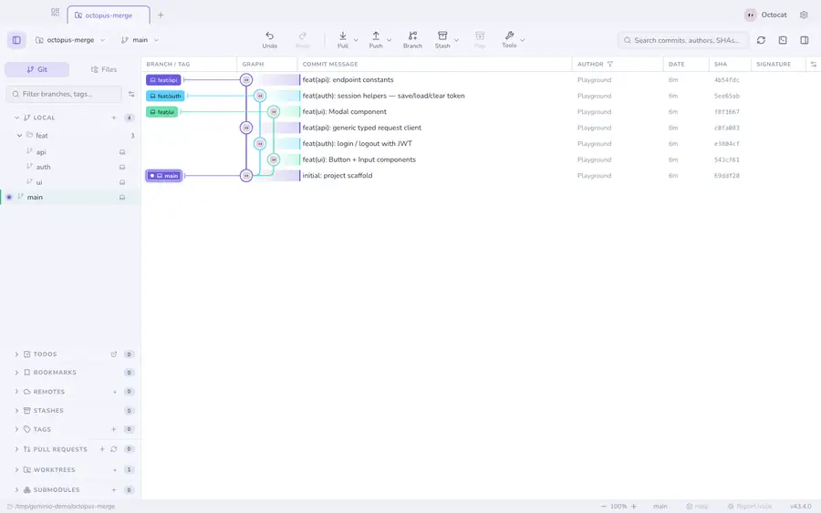
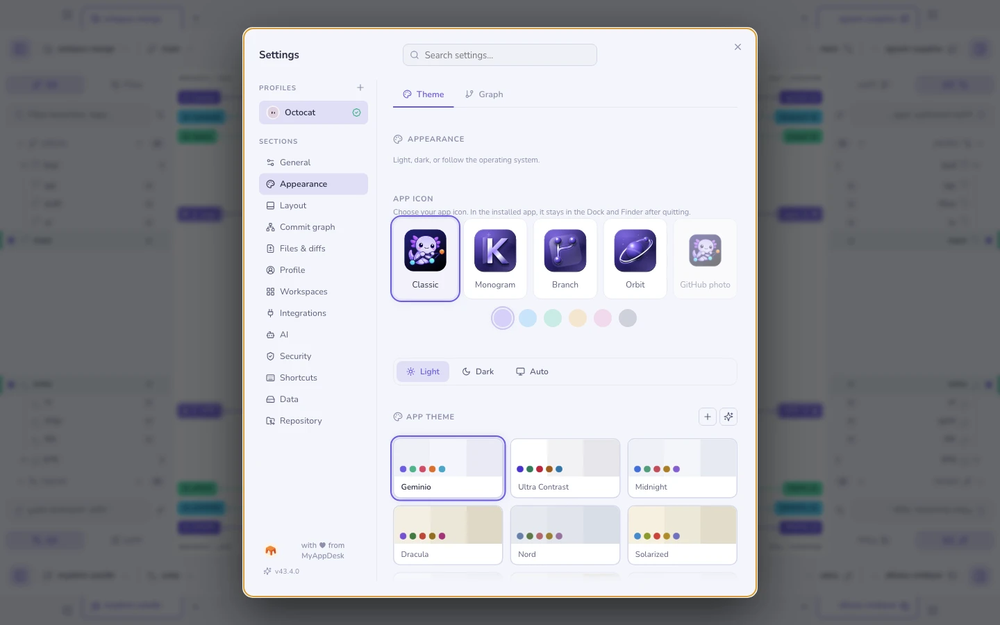
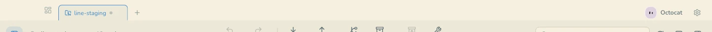
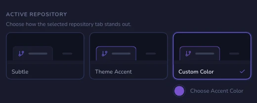
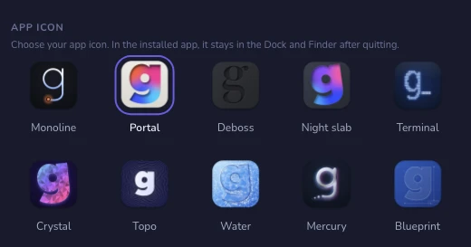

# Themes & appearance

Built-in themes — Geminio, Nord, Dracula, Solarized, GitHub, Monokai,
Midnight, Contrast and Daltonic — each with a light and a dark variant.

- **Light, dark, or follow the OS**, switched live.
- **Custom themes**, and **AI-generated** ones from a prompt.
- Adjustable **code font size**.
- **No scrollbars.** Trackpad, wheel and keyboard scrolling work as usual. In the details panel and in Settings, a list with more below fades out at its bottom edge, and the fade goes away once you reach the end. Only the cut edge fades — no blur, and a short list gets a shorter fade — so every row you can see stays fully readable.
- A separate **graph style**: lane palette, corner style, row density and line
  thickness, plus the ring, haze and bar on each commit row and how unpushed
  commits stand out, all with a live mini-graph preview.

## Commit rows

Every commit row is tied to its lane three ways: a **ring** around the avatar,
a **haze** running from the avatar to the message, and a **bar** beside the
message. All three take the lane's colour, which is why a one-branch
repository is all purple: that is lane 1 of the Classic palette. The preview
in **Settings → Themes → Graph** shows each change as you make it.

| Setting | Choices |
|---------|---------|
| Avatar ring | **Thin** (the default), **Normal** or **Thick**. Sits under *Node style*, since the ring belongs to the avatar |
| Commit rows | **Off**, **Ring**, **Ring + bar**, or **Full** (ring, bar and haze) |
| Row color | **Lane** (each row follows its lane) or **Custom** (one color for every row) |
| Unpushed commits | **Off**, **Dashed** (dashed ring, dotted bar), or **Dashed + arrow** (adds a small ↑ badge on the avatar) |
| Tint the row | Also washes the whole row of an unpushed commit |

"Unpushed" means no remote-tracking branch contains the commit, as of your
last fetch. A commit someone else already pushed still looks unpushed until you
fetch. A repository with no remote marks nothing, since every commit would
qualify.

## Tab status dots

A repository tab says what is waiting in it, most urgent first:

| Mark | Means |
|------|-------|
| Pulsing amber dot | A conflict is in progress. It replaces the other marks |
| Solid number | Commits no remote has yet, so they exist only on this machine. A new branch you have never pushed counts too |
| Muted grey dot | Uncommitted changes. Sits behind the number when there are both |

A folder of tabs adds up the commits of everything inside it. A group chip
keeps its own `↑` / `↓` counts.

**Settings → Themes → Theme → Tab status dots** picks a color for **Changes**,
**Conflict** and **Push**. The reset button next to each hands it back to the
theme.

## Active repository

**Settings → Appearance → Active repository** adds a thin accent outline around
the selected repository tab. It follows the theme by default. Pick a **Custom color**
for a fixed outline color, or choose **Theme accent** to follow the theme again.
Choose **Subtle** to return to the understated border.
This preference applies across repositories, including repositories inside groups.

## App icon

On macOS, **Settings → Appearance → App icon** offers ten illustrated icons:
Monoline (the default), Portal, Deboss, Night slab, Terminal, Crystal, Topo,
Water, Mercury and Blueprint. Your choice changes the Dock icon immediately. In
the installed app it also updates the Finder icon, so it stays selected after
you quit and relaunch. Choose **Monoline** to go back to the icon the app
shipped with. The chosen icon wears an accent ring around the icon itself, the
way iOS and macOS mark a chosen icon.

The icons are fixed artwork, so there are no color options, and the choice is
macOS-only. The development build changes only its running Dock icon, leaving
the shared Electron runtime untouched, and applies your saved choice again each
time it starts.

## Layout

Sidebar on the left or the right, resizable panels everywhere, a collapsible
sidebar for when the graph deserves the whole window, and per-repository
terminal placement.

**See also:** [The commit graph](graph.md) · [Profiles](profiles.md)
