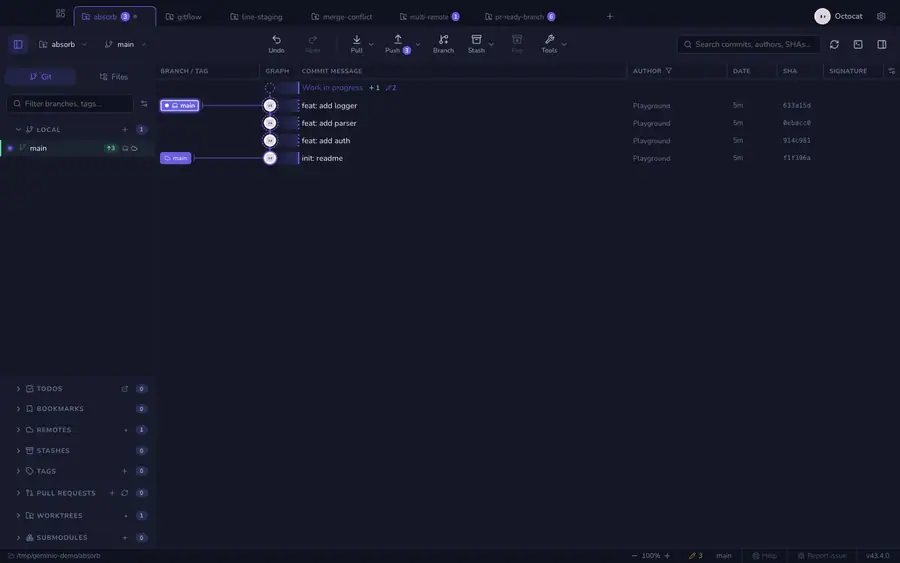
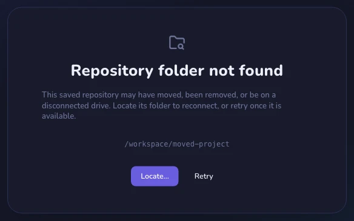
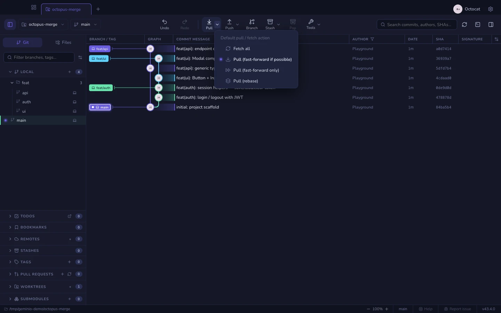
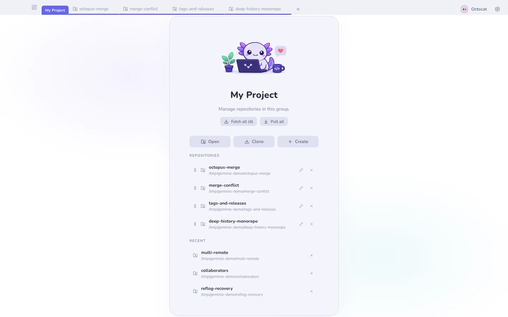
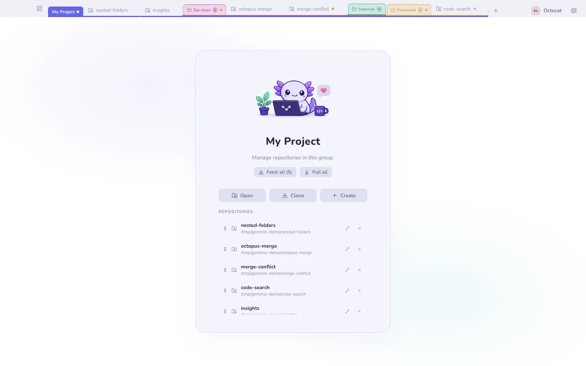

# Workspaces, tabs & groups

Graph columns and the sidebar's section order, visibility and expansion are
app-wide preferences. Arranging them in one repository updates all repositories.
Branch pins and branch-folder expansion remain specific to each repository.

Three levels, from loosest to tightest.

## Tabs

One repository, one tab. Use <kbd>⌘T</kbd> / <kbd>Ctrl+T</kbd> to open the
new-tab picker and <kbd>⌘W</kbd> / <kbd>Ctrl+W</kbd> to close the active tab.
You can also drag to reorder, middle-click to close, or press <kbd>⌘⇧T</kbd>
to reopen the last one you closed. Right-click a repository tab (or a chip
inside a [group](#groups)) for the [repository context menu](repo-menu.md) —
alias, worktrees, GitHub, terminal, reveal, editor, and remove. Close the last
tab and <kbd>⌘W</kbd> closes the window instead. A dot on the tab means
uncommitted work; a different one means conflicts.

If a close warning appears, <kbd>Escape</kbd> always cancels. <kbd>Enter</kbd>
confirms only when the tab is clean — when there are uncommitted changes or
conflicts the warning deliberately makes you reach for the button, so a stray
keypress after <kbd>⌘W</kbd> cannot close work you were still holding.

### Sorting tabs

With a dozen repositories open, the one waiting on a push is easy to lose.
Right-click any tab and open **Sort tabs**. It is one choice, and a lit dot
marks the active one: **Manual** (the default — tabs stay where
you drag them) or one of these orders, which the strip then keeps:

| Sort | Puts first |
|------|-----------|
| Needs attention | What is waiting, weighed by how fresh it is — see below |
| Unpushed commits | The most commits no remote has yet |
| Uncommitted changes | Tabs with work in the working tree |
| Behind remote | The most commits to pull |
| Name | A–Z, with numbers in natural order |
| Recently opened | The repositories you opened last |

**Needs attention** weighs what is waiting in each repository — a conflict
(100), unpushed commits (50), uncommitted changes (35), being behind its remote
(15), added up — by how fresh it is: the weight halves for every three days
since the last activity there (your newest unpushed commit, your newest edit to
a changed file, the fetch that put you behind). Work you are doing today comes
first; a commit left unpushed for months sinks below it, though it still sorts
above a clean repository. Two equally pressing tabs go by which you touched
most recently.

Other ties always break the same way — by conflicts, then unpushed, then
changes, then by name — so sorting twice gives the same strip. A group sorts by the totals of its
repositories; the repositories inside a group keep their own order.

A chosen order re-applies when a tab opens or closes and when the window comes
back into focus — not the moment a status changes, so a commit or push does not
slide a tab out from under the cursor while you work. Dragging a tab by hand
switches back to Manual. While an order is held, the **Sort tabs** row names it
(for example *Needs attention*), so you can tell without opening the flyout.

At launch the strip opens in the order it had when you quit, and waits until
every repository has loaded its status before re-sorting — so you see at most
one reorder, made with the full picture, rather than a sort that corrects
itself a second later.

Limits: page tabs (Settings, the changelog) stay at the end. A repository that
cannot load (a moved folder, not a git repository) sorts last. Counts are only
as fresh as the last refresh or fetch. Sorting applies to the current workspace.

## Working in several repositories

Each repository keeps its own selected commit, open file and viewer mode while
Geminio is running. Switch tabs or repository chips in a group, then return
to resume that repo's view. Closing a file in one repo leaves other repos' files
open. Graph search and filters, sidebar tab, and the details/chat tab also stay
with their repository.

The file reader remembers its scroll position, find query and unsaved editor
text when you switch away. Switching never writes those edits to disk; use
**Save** when ready. These working views are kept for the current app session.
Column arrangements, panel sizes, appearance and other layout preferences
remain shared across repositories.

## Moved or unavailable folders

A restored tab whose folder no longer exists shows **Repository folder not
found**, including its saved path. Background tabs do not show startup error
toasts for missing folders. Choose **Locate…** to reconnect the tab to the
folder's new location, or **Retry** after reconnecting its drive. Your saved
tab is kept until you reconnect or close it.

## Fetch and pull

The repository toolbar has one **Pull** button with a dropdown. Choose its
default action: **Fetch all**, **Pull (fast-forward if possible)**,
**Pull (fast-forward only)** or **Pull (rebase)**. Choosing an option saves the
preference; click the main button to run it. It reads **Fetch** when Fetch all
is selected. Fetch updates remote history without changing your files.

## Groups

Bundle related repositories into a named, colour-coded **group tab**. Inside a
group you get a second row with one chip per repository, and the group itself
can **Fetch all** or **Pull all** in one go.

Groups can hold **folders, nested to any depth**: right-click the group → *New
folder…*, then drag repositories onto a folder chip. Each folder takes a colour,
collapses to a counted chip, aggregates the status dots of everything inside it,
and can fetch or pull its whole subtree.

> Folders only organise. Deleting one lifts its repositories to the parent — it
> never closes a repository.

## Pages that belong to a repository

Some pages are not their own thing: a repository's [wiki](repo-wiki.md), its
[insights](insights.md), the [dev tools](devtools.md) a launch session
announced. They do not take a tab — they appear as small icons on the
repository itself.

- **Click an icon** to show that page. **Click it again — or click the
  repository's name** — to come back to the repository. While a page is
  showing, the name grows a pointer cursor and a small pill on hover: it is the
  way back.
- **Hover an icon** for the ✕ that closes just that page.
- Inside a **group**, the icons sit on the chip of the repository they belong
  to, and only while that repository is the selected one. Picking another repo
  in the group shows *that* repository, not its neighbour's tool.
- Re-opening the same page lights the icon it already has instead of adding a
  second one.

A repository that is not open anywhere has no icon to carry, so a page for it
opens as a tab of its own instead — opening something always opens something.

## Workspaces

A workspace is a **whole saved tab strip**. Switching swaps every tab at once:
`Work` and `Personal` stop stepping on each other.

Workspace management lives in **Settings → Workspaces**, where you can switch,
create, rename, reorder or delete workspaces. The title bar stays compact: its
small dashboard icon opens [Mission control](mission-control.md).
In macOS fullscreen, the padding for the window buttons disappears.

**See also:** [Mission control](mission-control.md) · [The command line](cli.md)
